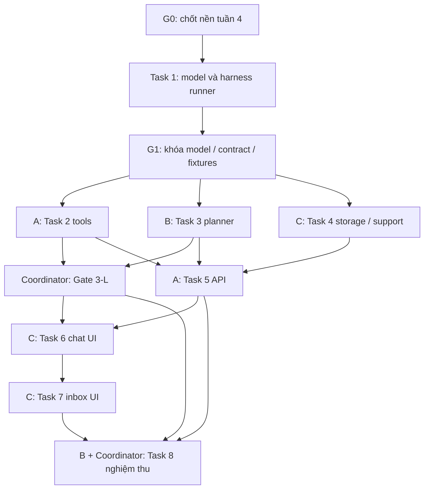

# Week 5 Asset Assistant Implementation Plan

> **For agentic workers:** REQUIRED SUB-SKILL: Use superpowers:subagent-driven-development (recommended) or superpowers:executing-plans to implement this plan task-by-task. Steps use checkbox (`- [ ]`) syntax for tracking.

**Goal:** Thêm trợ lý hỏi đáp tiếng Việt tra cứu dữ liệu tài sản thật theo quyền, hiển thị căn cứ và chuyển câu hỏi chưa giải quyết được đến MANAGER phòng ban hoặc ADMIN để phản hồi.

**Architecture:** Hướng 1 đã được người dùng chọn: Workers AI chuyển câu hỏi thành yêu cầu gọi công cụ có cấu trúc; Django xác thực, áp phạm vi dữ liệu và thực thi truy vấn qua ORM. Backend dựng số liệu/căn cứ từ kết quả thật, lưu hội thoại và phiếu hỗ trợ; React hiển thị chat và hộp thư người phụ trách. Tận dụng nền PostgreSQL/D1, AI Worker và xác thực của tuần 4; chưa triển khai khi tuần 4 đang thay đổi.

**Tech Stack:** Django 5.2.18, DRF, SimpleJWT, PostgreSQL/D1 adapter và `d1_batch` hiện có; React JSX, React Router, Tailwind, axios; Cloudflare Workers AI model `@cf/meta/llama-3.1-8b-instruct-fp8`; pytest, Vitest, MSW, Playwright. Dùng `jsonschema` đã có, không thêm dependency.

**Spec:** [2026-11-05-week-5-asset-assistant-design.md](../specs/2026-11-05-week-5-asset-assistant-design.md). Executor đọc cả hai tài liệu. Phương án tổng thể đã chọn; các mặc định kỹ thuật trong spec/plan cần được người dùng xem trước khi thực thi.

## Global Constraints

- Chỉ viết tài liệu trong phiên lập kế hoạch; không sửa code/cấu hình tuần 4, cài thư viện, khởi động lại dịch vụ hoặc deploy cloud.
- Giữ Django 5.2.18, DRF, React JSX và các phiên bản đã khóa; không thêm dependency cho bản đầu.
- CSDL nghiệp vụ khi triển khai là D1; PostgreSQL tiếp tục dùng cho phát triển/đối chiếu theo nền tuần 4.
- Xác thực dùng JWT hiện có; không đưa token hoặc hội thoại vào localStorage/sessionStorage.
- USER chỉ xem tài sản đang giữ và lịch sử cá nhân đã được lọc; MANAGER chỉ xem phòng ban mình; ADMIN xem toàn hệ thống.
- AI chỉ chọn công cụ và tham số; backend kiểm tra schema, phân quyền, thực thi và tạo căn cứ. Không thực thi SQL/code/URL từ đầu ra mô hình.
- Không thay đổi quyền hoặc hành vi `/api/ai/suggest-category/`.
- Không tự bật tính năng trả phí hoặc tạo/deploy tài nguyên Cloudflare; nghiệm thu cloud chỉ khi người dùng yêu cầu ở bước thực thi.
- Không tự bật skill khác, phân công agent hoặc thực thi plan; phương thức thực thi do người dùng chọn sau khi xem tài liệu.
- Phiên cập nhật tài liệu này chỉ sửa hai file spec/plan hiện có; không gọi subagent, sửa code/cấu hình, cài đặt, chạy test, gọi AI, deploy, commit hoặc push.

## Review Focus

1. **Rò dữ liệu qua count, tên trùng hoặc câu nối tiếp:** áp quyền trước tìm kiếm/tổng hợp; không đọc lại số liệu cũ sau đổi quyền/phòng ban. Tests thuộc Tasks 2 và 5.
2. **Trả lời có số/nguồn sai dù JSON hợp lệ:** tổng trên toàn tập dữ liệu, nguồn do backend tạo; 0 và dữ liệu không có phải phân biệt với lỗi. Tests thuộc Tasks 2 và 5.
3. **Gửi lại request hoặc mất mạng sau commit:** một lượt/một ticket, không báo đã chuyển khi trạng thái commit chưa rõ. Tests thuộc Tasks 4 và 8.
4. **Nhiều manager, không có manager hoặc reply đồng thời:** inbox phòng ban, fallback ADMIN, CAS giữ nguyên câu trả lời thắng. Tests thuộc Tasks 4, 7 và 8.
5. **Model/infrastructure hoặc nội dung người dùng bất thường:** JSON/SQL/prompt injection/UTF-8 oversized bị chặn; React render text; model lỗi không bị diễn giải thành kết quả rỗng. Tests thuộc Tasks 3, 5 và 6; chất lượng hiểu tiếng Việt được kiểm tra riêng ở Gate3-L trước hoàn thiện UI.

---

## Cách dùng kế hoạch và điểm bắt đầu

Đây là **một tính năng xuyên suốt**, không chia thành những dự án triển khai độc lập: công cụ, hội thoại và hộp thư dùng chung quyền, model và API. Giữ 8 task có đầu ra kiểm tra riêng. Nếu làm Native: `1 → chốt contract → 2 → 3 → Gate 3-L → 4 → 5 → 6 → 7 → 8`. Phương án AGY song song bên dưới chỉ mở những nhánh đã đủ điều kiện, không mở cả 8 task cùng lúc.

Trước Task 1, executor phải đọc trạng thái tuần 4, thống nhất commit nền đã ổn định với người dùng và xem lại tên miền/Worker/D1 thực tế. Không checkout/reset/stash các thay đổi tuần 4 của phiên khác; không tự tạo worktree hoặc tích hợp nhánh. Plan đang dựa trên nhánh `feat/cloudflare-d1`, HEAD quan sát lúc lập là `a4f8360`; đây không phải commit nền mặc định để triển khai về sau.

Các lệnh dưới đây chạy từ thư mục gốc repository và đều là **công việc tương lai**, không chạy trong phiên sửa tài liệu này. Mọi lệnh backend cần PostgreSQL phải đi qua runner cô lập mô tả tiếp theo; không dùng instance phục vụ ứng dụng ở port5433, cũng không coi port5434 mặc nhiên là DB test. Toàn bộ mạng AI mặc định được mock/chặn, trừ lượt đánh giá thật được cho phép riêng ở Gate 3-L. Lệnh commit là bước của coordinator khi thực thi được yêu cầu, không phải quyền để workers commit đồng thời; chỉ stage đúng tệp của task, không `git add .`.

### PostgreSQL kiểm thử: khởi tạo, truyền cấu hình và teardown

Runner **sẽ tạo trong Task 1**, chưa tồn tại/chưa được chạy ở phiên này: `backend/tests/assistant/run_isolated_checks.py`, entry `main(argv: list[str] | None = None) -> int`. Nó nhận các đối số Python sau `--` và chạy `[sys.executable, *child_args]` trong subprocess từ repo root, không ghép shell. Mặc định `--database postgres`; `--database none` dành cho D1-only checks.

1. Dùng `PGSourceHarness` từ `backend/apps/common/tests/harness_pg_source.py`, không sửa harness tuần4. Kiểm tra Docker và image `postgres:16-alpine` đã có; thiếu thì dừng với thông báo prerequisite, không tự cài/pull. Mỗi invocation sinh `run_id=w5_<random>`, DB `assethub_w5_<run_id>`, test DB `test_assethub_w5_<run_id>` và port trống từ bind loopback port0. Harness kiểm tra lại port khi start; mất cuộc đua port thì dừng, không nối listener vừa chiếm port.
2. Khởi tạo `PGSourceHarness(run_id=..., host="127.0.0.1", port=chosen_port, dbname=...)`; gọi **`start(recreate=False)` trong try/finally**, không `setup()`/`with PGSourceHarness(...)`/singleton: các đường đó seed dữ liệu diễn tập tuần4. Chỉ dùng admin credentials ngẫu nhiên do harness tạo trên container này; không lấy tài khoản ứng dụng hoặc tài khoản read-only của migration rehearsal để chạy write tests.
3. Trước child, xác minh tên container, nhãn `assethub.run_id=<run_id>` và `assethub.owner=rehearsal`, trạng thái running và mapping `127.0.0.1:<chosen_port>:5432`. Port trống hoặc tên test DB riêng lẻ không phải bằng chứng ownership. Không reuse một harness/container của worker khác.
4. Child env ghi đè rõ `DJANGO_SETTINGS_MODULE=assethub_api.settings`, `USE_D1_DATABASE=False`, `DB_HOST`, `DB_PORT`, `DB_NAME`, `DB_USER`, `DB_PASSWORD` từ đúng harness và `TEST_DB_NAME` theo run_id; truyền marker `ASSETHUB_WEEK5_PG_RUN_ID`. Không in credentials hoặc ghi `.env` đang dùng. Pytest-django tạo/migrate test DB bằng account trên instance sở hữu; `--reuse-db` chỉ reuse bên trong vòng đời đó, không reuse instance tuần4. Management checks cũng đi qua runner; fixture tuần5 seed riêng, không seed qua harness migration cũ.
5. Đặt rỗng `D1_BRIDGE_URL`, `D1_BRIDGE_SECRET_TOKEN`, `D1_BRIDGE_TOKEN`, `POSTGRES_RO_USER`, `POSTGRES_RO_PASSWORD`, `R2_ACCESS_KEY_ID`, `R2_SECRET_ACCESS_KEY`, `R2_BUCKET_NAME`, `R2_ENDPOINT_URL`, `AI_WORKER_URL`, `AI_SERVICE_TOKEN` trong child trước khi Django/load_dotenv được import; không chỉ pop để `.env` có thể nạp lại. Mặc định đặt `RUN_ASSISTANT_LLM_EVAL=0`, rỗng `ASSISTANT_EVAL_WORKER_URL`, marker `ASSETHUB_WEEK5_LIVE_AI_ALLOWED=0`. Chỉ chế độ `--allow-live-ai` cùng opt-in đầu vào `RUN_ASSISTANT_LLM_EVAL=1`, sau sự cho phép của người dùng và endpoint Gate3-L đã xác nhận, mới đặt marker=1, giữ token server-to-server và ánh xạ endpoint đã duyệt vào `AI_WORKER_URL`; D1/R2 vẫn tắt. Không truyền JWT người thật cho đánh giá.
6. Đợi child; khi exception/KeyboardInterrupt, kết thúc và đợi child trước. `finally` luôn gọi `harness.teardown()`, kể cả start lỗi giữa chừng; chỉ xóa container có hai nhãn đúng run. Ghi lại anonymous volume IDs mới của đúng container sau start hoặc trong finally trước teardown: helper tuần4 chỉ `docker rm -f`, chưa dọn volume. Chỉ xóa từng volume có provenance được tạo trong lượt này và không còn container khác tham chiếu; giữ named/bind/pre-existing volumes và mọi trường hợp không chứng minh được sở hữu, báo cleanup chưa hoàn tất. Giữ exit code lỗi của child; child thành công nhưng cleanup lỗi cũng không báo check thành công. Không `docker compose down`, prune, kill theo port hoặc xóa theo prefix; không đụng `assethub-db-1`, `pg-test` hay volume tuần4.
7. Chế độ `--database none` không khởi động PostgreSQL: env DB_HOST trỏ đường Unix socket tạm **không tồn tại**, DB_USER/PASSWORD vô hiệu, không có fallback đến `.env`; fixture D1 phải thay default trước ORM I/O. Gọi PostgreSQL bất ngờ phải lỗi trước kết nối tới instance thật. Các tests D1 vẫn dùng harness loopback và ownership riêng như Task8; không request fixture `db` PG.

Ví dụ tương lai: `backend/.venv/bin/python backend/tests/assistant/run_isolated_checks.py -- -m pytest backend/tests/assistant/test_models.py -q`. Không chạy trực tiếp pytest/management checks cần DB với cấu hình mặc định. Runner được bootstrap và kiểm tra an toàn trước model tests của Task1; chưa đủ prerequisites thì đánh dấu BLOCKED/NOT RUN, không đổi endpoint để làm xanh tests.

### Phân công AGY dự kiến: phụ thuộc và quyền sửa tệp

Chỉ áp dụng khi người dùng chọn cách AGY sau này. **G0**: nền tuần4 đã chốt + yêu cầu thực thi được xác nhận. **G1**: Task1 model/migration và runner đã được tích hợp; coordinator chốt phần contract đầu Task2 (`contracts.py`, JSON schema, DTO/API, chữ ký tools/storage và context follow-up) cùng fixtures. Phần implementation tools của Task2 chưa cần xong để mở Task3/4.



| Task / điều kiện bắt đầu | Worker và tệp độc quyền | Coordinator tích hợp tệp dùng chung |
|---|---|---|
| 1, sau G0 | **A**: app init/apps/models, migrations, additive D1 SQL, `test_models.py` | `settings.py`; runner/`test_isolated_checks.py`; `backend/tests/assistant/{__init__,conftest,factories}.py` |
| 2, phần tools sau G1 | **A**: `scoping.py`, `tools.py`, `knowledge.py`, `rendering.py`, `knowledge/procedures.json`, `test_tools.py`, `test_knowledge.py` | `contracts.py`, `plan.schema.json`, `test_contracts.py`; chốt chúng ở đầu task trước G1 |
| 3, sau G1; không chờ tools xong | **B**: Worker `assistant.js`, schema mirror, `assistant.test.js`; `gateway.py`, `test_gateway.py` | Worker `src/index.js`, settings timeout; nhận test parity từ B để thêm vào `test_contracts.py` |
| 4, sau G1; độc lập implementation Task2/3 | **C**: `storage.py`, `support.py`, `test_storage.py`, `test_support.py` | Common fixtures nếu cần; C không sửa conftest của A/B |
| Gate3-L, sau Task2+3 | **Coordinator**: bộ ca/runner live-eval được khai báo dưới Gate3-L; B hỗ trợ phân tích kết quả | Quyền gọi AI, endpoint/budget và kết luận gate; không tự đổi contract theo output model |
| 5, sau Task2+3+4 | **A**: `services.py`, `serializers.py`, `pagination.py`, `views.py`, `test_chat_service.py`, `test_api.py` | `backend/apps/assistant/urls.py`, `backend/assethub_api/{urls,settings}.py` |
| 6, tích hợp sau Task5+Gate3-L PASS | **C**: chat page/components và `AssetAssistant.test.jsx` | `assistantApi.js`, `App.jsx`, `Sidebar.jsx`, `Sidebar.test.jsx` |
| 7, sau Task6; giữ Gate3-L PASS | **C**: support page/panel, `AssistantSupport.test.jsx`, phần reply trong `AssetAssistant.test.jsx` | Cùng API client/routes/Sidebar/tests của Task6, chỉ coordinator sửa |
| 8, D1/API checks sau Task5; nghiệm thu đầy đủ sau Task6+7+Gate3-L | **B**: `d1_fixtures.py`, `test_d1_rehearsal.py`, `assistant.spec.js`, `playwright.assistant.config.js` | Env examples/Compose/wrangler/README/runbook; gom chứng cứ và kết luận cuối |

Tối đa **3 worker + 1 coordinator**, giảm nếu AGY ít slot hơn. Sau G1, chỉ Task2/3/4 chạy song song đầy đủ. C có thể chuẩn bị component/MSW của Task6 sau khi xong Task4 và contract đã khóa; chưa tích hợp/đóng Task6–7 trước Task5 và Gate3-L. B có thể dựng fixture Task8 sau Task3, nhưng không tuyên bố nghiệm thu khi các phụ thuộc còn thiếu. Khi chưa được phép gọi AI, tiếp tục phần offline này và giữ gate pending.

Mỗi task vẫn cần bàn giao diff, kết quả checks và chữ ký/DTO đúng G1. `Files` của task là phạm vi deliverable, **không cấp quyền mọi worker sửa tất cả file trong mục đó**; ownership bảng trên có ưu tiên. `frontend/src/api/axiosClient.js` dùng lại nguyên trạng; mọi thay đổi API client cần thiết, kể cả `assistantApi.js`, qua coordinator. Workers đề nghị sửa shared file/contract bằng ghi chú; coordinator tích hợp tuần tự và chạy checks của task trước khi đóng. Đổi contract phải thông báo các nhánh phụ thuộc và chạy lại contract checks; chỉ đổi nội bộ thuật toán không mở lại nghiệp vụ.

## Bản đồ tệp và trách nhiệm

| Nhóm tệp | Trách nhiệm |
|---|---|
| `backend/apps/assistant/{__init__,apps,models}.py`, `migrations/0001_initial.py` | App riêng; Conversation, ChatTurn, SupportTicket |
| `backend/assethub_api/backends/d1/sql/0002_week5_assistant.sql` | DDL bổ sung, không thay schema nền tuần 4 |
| `backend/apps/assistant/{contracts,scoping,tools,knowledge,rendering}.py`, `plan.schema.json`, `knowledge/procedures.json` | Contract JSON, phạm vi truy vấn, tool registry, hướng dẫn có version, câu trả lời/căn cứ |
| `cloudflare-worker/src/assistant.js`, `assistant.schema.json`; sửa `src/index.js` | Endpoint planner mới, giữ nguyên endpoint category |
| `backend/apps/assistant/gateway.py` | Gọi Worker có auth, giới hạn body/timeout, xác thực output |
| `backend/apps/assistant/{storage,support}.py` | Reserve/finalize turn, atomic handoff, routing và reply OCC |
| `backend/apps/assistant/{services,serializers,pagination,views,urls}.py` | Điều phối hỏi đáp và HTTP API |
| `backend/assethub_api/{settings,urls}.py` | Đăng ký app, feature flag và API prefix |
| `backend/tests/assistant/` | Các bài kiểm tra riêng và factories; không sửa harness tuần 4 để bỏ guard |
| `backend/tests/assistant/run_isolated_checks.py`, `test_isolated_checks.py` | Runner tái dùng PGSourceHarness, cấu hình child và cleanup theo ownership; tạo ở Task1, coordinator sở hữu |
| `backend/tests/assistant/planner_eval_cases.json`, `test_planner_live_eval.py` | Bộ đánh giá LLM sớm và gate opt-in sau Task3; coordinator sở hữu |
| `frontend/src/api/assistantApi.js`, `pages/AssetAssistantPage.jsx`, `components/assistant/{AssistantTurn,AssistantSources}.jsx` | Chat, request ID, nguồn và phản hồi trong hội thoại |
| `frontend/src/pages/AssistantSupportPage.jsx`, `components/assistant/SupportTicketPanel.jsx` | Inbox và phản hồi người phụ trách |
| `frontend/src/{App.jsx,components/Sidebar.jsx}`, tests | Route/menu theo vai trò và feature flag |
| `.env.example`, `deploy/.env.demo.example`, `deploy/docker-compose.demo.yml`, `cloudflare-worker/wrangler.toml` | Chỉ bổ sung cấu hình tuần 5 **sau khi** nền tuần 4 được chốt |
| `docs/week-5-demo-guide.md`, `README.md` | Hướng dẫn bật/tắt, nghiệm thu và demo có bằng chứng |

Giữ `knowledge.py` và thư mục dữ liệu `knowledge/` cùng cấp (thư mục dữ liệu không có `__init__.py`). Không gom orchestration, SQL và HTTP vào một file lớn; cũng không refactor các app tài sản đang hoạt động.

## Contract dùng chung giữa các task

Spec §§6–10 là nguồn đầy đủ cho schema, enum, field và API. Các giới hạn cần giữ nguyên: question 1000 ký tự; answer 6000; reply 4000; context 6 lượt/6000 ký tự; tối đa 3 tool calls; tool list tối đa 20 bản ghi; pending 180 giây; Worker 32 KiB UTF-8; rate 10 lượt mới/phút/user.

Các tên JSON được giữ nguyên xuyên backend/worker/frontend: `client_request_id`, `conversation_id`, `outcome`, `sources`, `observed_at`, `scope_label`, `ticket`, `target_kind`, `expected_version`. `observed_at` là ISO 8601 UTC. `href` có thể null. Backend là nguồn có thẩm quyền cho phạm vi và evidence.

Hành vi kết hợp nhiều tools: nếu có `restricted`, toàn lượt là RESTRICTED; nếu không, có `clarify` thì hỏi lại; nếu không, có `unsupported` thì handoff; tất cả `ok` mới dựng câu trả lời dữ liệu. Không tạo câu trả lời tổng hợp một phần rồi bỏ im điều kiện chưa giải quyết được.

### Task 1: Dữ liệu hội thoại và phiếu hỗ trợ trên PostgreSQL/D1

**Files:**
- Create: `backend/apps/assistant/__init__.py`, `apps.py`, `models.py`, `migrations/__init__.py`, `migrations/0001_initial.py`.
- Create: `backend/assethub_api/backends/d1/sql/0002_week5_assistant.sql`.
- Create khi thực thi: `backend/tests/assistant/run_isolated_checks.py`, `test_isolated_checks.py` — coordinator, không sửa harness tuần4.
- Modify: `backend/assethub_api/settings.py` — thêm `apps.assistant.apps.AssistantConfig` vào INSTALLED_APPS.
- Test: `backend/tests/assistant/__init__.py`, `conftest.py`, `factories.py`, `test_models.py`.

**Interfaces:**
- Consumes: `User`, `Department`; migrations `authentication/0002_alter_user_email.py`, `departments/0002_category.py` quan sát hiện tại; xác nhận lại sau tuần 4.
- Produces: `Conversation`, `ChatTurn`, `SupportTicket` và toàn bộ field/enum của spec §8; relation reverse `Conversation.turns`, `ChatTurn.ticket`.
- Produces runner: `main(argv: list[str] | None = None) -> int` và hai mode/child env theo mục PostgreSQL cô lập ở đầu plan; dùng được cho pytest và `backend/manage.py` checks. Coordinator bootstrap runner trước lượt model tests, rồi bàn giao command chuẩn cho A/B/C.
- Produces test helper: `build_assistant_graph(using: str = "default") -> dict` trong `factories.py`; fixture PG `assistant_graph(db)` trong conftest gọi helper. Trả keys `admin`, `manager_it`, `manager_hr`, `user_it`, `user_hr`, `other_it_user`, `it`, `hr`, `laptop`, `held_asset`. Dữ liệu: 23 laptop AVAILABLE IT, 2 laptop IN_USE IT (mỗi user IT giữ 1), 1 màn hình hỏng IT, 2 laptop AVAILABLE HR, 1 laptop IN_USE HR; log cấp phát/hoàn trả của user IT và log người khác. Factory dùng `.using(using)`/`.db_manager(using)` nhất quán. Không dùng chung test case với parent user/department fixtures có cùng mã IT/HR; test dùng graph thì lấy toàn bộ actor/department từ graph.

`other_it_user.full_name` trong graph là tên giả, không rỗng và duy nhất “Nhân viên IT B”, để ca vượt quyền Gate3-L không vô tình biến thành câu mơ hồ.

- [ ] **Step 1: Viết failing tests cho model constraints và bảo toàn dữ liệu**

`test_turn_request_id_is_unique_per_conversation`: tạo cùng `(conversation, client_request_id)` lần hai phải IntegrityError; ID ở conversation khác hợp lệ. `test_only_one_processing_turn_per_conversation`: pending thứ hai phải lỗi, sau finalize có thể tạo lượt mới. `test_ticket_is_unique_per_turn_and_reply_state_is_consistent`: duplicate turn hoặc ANSWERED thiếu reply/by/time phải lỗi. `test_ddl_is_additive_and_reentrant`: áp DDL lên SQLite tạm có sentinel, chạy hai lần, sentinel nguyên vẹn; assert tên cột/index/FK/check khớp model, UUID lưu dạng 32 hex như Django SQLite. SQLite này chỉ chứng minh DDL, chưa thay thế D1 thật.

Thêm safety tests của runner với subprocess/harness được mock: `test_runner_injects_only_owned_pg_settings` kiểm tra DB_* và TEST_DB_NAME trùng harness; `test_busy_port_or_foreign_labels_prevent_child` child call_count=0, không xóa listener lạ; `test_child_failure_and_interrupt_teardown_owned_harness` cleanup đúng run_id khi exit1/KeyboardInterrupt; `test_volume_cleanup_requires_run_provenance` giữ volume ngoài sở hữu, báo lỗi nếu cleanup không được xác nhận; `test_missing_image_does_not_pull_or_fallback` không gọi pull/không dùng port5433/5434 làm fallback; `test_default_mode_clears_cloud_and_none_mode_has_no_pg` không khởi PG ở mode none, không giữ AI credentials khi chưa có cả quyền và opt-in. Không import Django trong runner trước khi dựng child env.

```python
def test_turn_request_id_is_unique_per_conversation(conversation, request_id):
    ChatTurn.objects.create(conversation=conversation, client_request_id=request_id,
                            question="Tôi đang giữ tài sản nào?", outcome="ANSWERED")
    with pytest.raises(IntegrityError), transaction.atomic():
        ChatTurn.objects.create(conversation=conversation, client_request_id=request_id,
                                question="Câu khác", outcome="ANSWERED")
```

Fixtures `conversation` và `request_id` được định nghĩa trong conftest mới, owner là `regular_user`, snapshot lấy từ owner. Tests constraint trên PG dùng transaction/savepoint để lỗi không làm hỏng test kế tiếp.

- [ ] **Step 2: Chạy tests mới, xác nhận thất bại đúng vì app/model chưa tồn tại**

Run sau bootstrap runner: `backend/.venv/bin/python backend/tests/assistant/run_isolated_checks.py -- -m pytest backend/tests/assistant/test_models.py -q`. Expected RED vì app/model chưa tồn tại. Bootstrap có vòng RED/GREEN riêng cho `test_isolated_checks.py` (harness/subprocess mock), không được dùng kết quả “runner chưa tồn tại” làm chứng cứ lỗi model.

- [ ] **Step 3: Cài đặt models và hai đường schema**

Định nghĩa field theo spec, choices kèm DB check, index owner/date, conversation/date và target/status/date; unique request/pending/ticket. Ticket DEPARTMENT bắt buộc department; ADMIN bắt buộc null; reply OPEN trống và ANSWERED có nội dung/by/time. Dùng `migrations.swappable_dependency` cho User; tạo migration đúng dependencies tại thời điểm thực thi. SQL mới chỉ CREATE TABLE/INDEX IF NOT EXISTS, không đụng 19 bảng nền. FK giữ dữ liệu tham chiếu bằng PROTECT, không cung cấp API xóa. Hướng dẫn đồng bộ migration metadata D1 sẽ nằm Task 8.

Coordinator cài runner theo vòng đời đã chốt, không copy hoặc sửa PGSourceHarness. Child env đầy đủ được dựng trước import Django; không dùng `harness.setup()` để tránh bộ seed tuần4 làm sai tổng fixture tuần5.

- [ ] **Step 4: Chạy lại tests và kiểm tra migration**

Run lệnh Step 2 và safety tests qua cùng runner; expected PASS, chỉ container sở hữu được tạo/xóa. Run: `backend/.venv/bin/python backend/tests/assistant/run_isolated_checks.py -- backend/manage.py makemigrations --check --dry-run`; expected không còn model change chưa có migration. D1 thật còn phải qua Task 8.

- [ ] **Step 5: Commit riêng Task 1**

Stage các tệp Task 1; `git commit -m "feat(assistant): add conversations and support ticket schema"`.

### Task 2: Công cụ tra cứu có phân quyền và căn cứ đáng tin

**Files:**
- Create: `backend/apps/assistant/contracts.py`, `plan.schema.json`, `scoping.py`, `tools.py`, `knowledge.py`, `knowledge/procedures.json`, `rendering.py`.
- Test: `backend/tests/assistant/test_tools.py`, `test_knowledge.py`, `test_contracts.py`.

**Interfaces:**
- Consumes: models hiện có và `assistant_graph`; serializer field allowlist trong `apps/assets/history_api.py`.
- Produces TypedDict: `PlannerDecision`, `ToolCall`, `ToolResult`, `Evidence`, `RoutingTarget` theo spec. `RoutingTarget = {kind: "DEPARTMENT"|"ADMIN", department_id: int|None}`.
- Produces: `validate_decision(payload: object) -> PlannerDecision`, raise `PlannerProtocolError` nếu sai contract; `visible_assets(actor: User) -> QuerySet`, `visible_history(actor: User, asset_code: str|None = None) -> QuerySet`, `visible_requests(actor: User) -> QuerySet`.
- Produces: `execute_tool(*, actor: User, call: ToolCall) -> ToolResult`; registry đúng 5 tên spec. `lookup_procedure(*, actor: User, topic: str) -> ToolResult`; `render_tool_results(results: list[ToolResult]) -> tuple[str, list[Evidence]]`.

- [ ] **Step 1: Viết tests chứng minh quyền, tổng đầy đủ, giải tham chiếu và nguồn**

`test_user_cannot_query_other_holder_or_department`: status restricted, không có tên/count ngoài quyền; `test_manager_summary_counts_entire_filtered_set`: manager IT nhận total 23 laptop AVAILABLE dù list trả 20; HR không góp vào tổng. `test_admin_and_user_scopes`: admin thấy tổng 29 tài sản, user IT chỉ 1 tài sản đang giữ. `test_duplicate_name_requires_clarification`: không lấy bản ghi đầu. `test_history_matches_personal_history_allowlist`: USER chỉ event from/to mình, không xuất actor/reason/email/phone/người giữ khác. `test_zero_is_an_answer_not_a_handoff`: total 0, sources còn có điều kiện/phạm vi. `test_sources_are_server_generated_and_role_accessible`: USER không được href `/assets/{id}`; aggregate có facts filters/total và field `observed_at`; renderer không nhận prose/URL do model cung cấp. `test_invalid_tool_or_orm_path_is_rejected_before_queries`: SQL, `__` lookup, unknown keys, bool limit, quá 3 calls, ngày đảo và enum lạ bị từ chối.

```python
def test_manager_summary_counts_entire_filtered_set(assistant_graph):
    g = assistant_graph
    result = execute_tool(actor=g["manager_it"], call={"name": "assets.summary",
        "arguments": {"category": "Laptop", "statuses": ["AVAILABLE"], "group_by": None}})
    assert result["data"]["total"] == 23
    assert result["status"] == "ok"
    assert result["sources"][0]["facts"]["total"] == 23
```

- [ ] **Step 2: Chạy tests mới và xác nhận thất bại đúng**

Run: `backend/.venv/bin/python backend/tests/assistant/run_isolated_checks.py -- -m pytest backend/tests/assistant/test_tools.py backend/tests/assistant/test_knowledge.py backend/tests/assistant/test_contracts.py -q`.

- [ ] **Step 3: Cài đặt contract, truy vấn và renderer**

Schema JSON nguồn có `$id="urn:assethub:assistant-plan:v1"`, root decision dùng đúng bốn khóa spec, không thêm field version vào decision; enum/tool parameters đóng, không ORM path tùy ý. Validate bằng `jsonschema`; phân biệt lỗi model protocol với lỗi question người dùng. Scope trước filters; USER có filter department hoặc holder khác mình trả restricted. ADMIN/MANAGER mới có bộ lọc department hợp lệ; manager yêu cầu phòng khác trả restricted mà không kiểm tra sự tồn tại trong phòng khác. Code/serial khớp chính xác trước; tên dùng chuẩn hóa `unicodedata` và danh sách kết quả có giới hạn, nhiều khớp phải clarify. Không đưa tất cả danh mục/user của CSDL sang model để dò tên.

`assets.search` data `{items, total, has_more}`; `assets.summary` `{total, groups, has_more}`; history/requests `{items, total, has_more}`; procedure `{topic, version, title, body, actions}`. Count thực hiện trước slicing. Dates UTC; không hiểu `updated_at` là ngày trả. Knowledge có 5 topic spec, đối chiếu services/permissions đang chạy; link theo vai trò. Renderer tạo câu tiếng Việt từ những trường này, giới hạn answer 6000 bằng cách giảm số dòng và ghi “đang hiển thị …”, không cắt âm thầm tổng/nguồn.

- [ ] **Step 4: Chạy lại tests và đối chiếu tập quyền với API hiện có**

Run Step 2; expected PASS. Thêm test so sánh ID từ `visible_assets` với `AssetViewSet.get_queryset()` trên ba vai trò trong graph, và history USER với `PersonalAssetHistoryView`; expected bằng nhau. D1 local query parity thuộc Task 8.

- [ ] **Step 5: Commit riêng Task 2**

Stage các tệp Task 2; `git commit -m "feat(assistant): add scoped asset query tools and evidence"`.

### Task 3: Planner Workers AI và gateway có hợp đồng chặt

**Files:**
- Create: `cloudflare-worker/src/assistant.js`, `assistant.schema.json`, `tests/assistant.test.js`.
- Modify: `cloudflare-worker/src/index.js` — route mới trước nhánh 404, giữ handler category hiện có.
- Create: `backend/apps/assistant/gateway.py`.
- Modify: `backend/assethub_api/settings.py` — khai báo `ASSISTANT_AI_TIMEOUT_SECONDS=30` cho gateway.
- Test: `backend/tests/assistant/test_gateway.py`; mở rộng `test_contracts.py` để so JSON hai deployment.

**Interfaces:**
- Consumes: `PlannerDecision`, `validate_decision`, schema Task 2.
- Produces Worker export: `handleAssistantPlan(request, env) -> Promise<Response>` cho `POST /api/assistant/plan`.
- Produces Python: `plan_question(*, question: str, context: list[dict], scope: dict) -> PlannerDecision`; raise `AssistantProviderUnavailable` khi timeout/network/429/5xx/JSON không hợp lệ.
- Worker request `{question, context, scope}`; response 200 `{decision: PlannerDecision}`. `scope` chỉ là metadata mô tả, không trao quyền. Worker status 400/401/405/413/429/502/503 có error code cố định; không trả raw provider error.

- [ ] **Step 1: Viết tests cho auth, bytes, model output và regression category**

Worker tests: missing/empty/wrong service token →401 không gọi AI; GET →405; JSON không hợp lệ →400; UTF-8 vượt 32768 bytes dù ký tự ít hơn →413; AI JSON tools/clarify/handoff hợp lệ →200; code fence/SQL/tool name lạ/output quá lớn →502; 429/timeout/upstream failure không trả data thành công. Assert prompt chỉ có system do server tạo; nội dung user/context không được nâng thành system role; không gọi `env.DB`.

Gateway tests: validate schema nested trước dispatch; headers server token, timeout 30; scope có server clock UTC và display timezone Việt Nam, không nhận role/now từ client; không theo redirect sang host khác mang token; không gửi JWT/password; provider 401/429/network/JSON sai → `AssistantProviderUnavailable`. Schema parity test đọc hai file JSON từ repo bằng Path và assert equality.

```javascript
it('does not query D1 when planning an asset question', async () => {
  env.AI.run.mockResolvedValue({response: JSON.stringify(validDecision)});
  const res = await worker.fetch(assistantRequest(validPayload), env);
  expect(res.status).toBe(200);
  expect(env.DB.prepare).not.toHaveBeenCalled();
});
```

`validDecision`, `validPayload`, `assistantRequest` là fixtures/helpers trong `assistant.test.js`, không nhập từ category tests.

- [ ] **Step 2: Chạy Worker và gateway tests, xác nhận thất bại đúng**

Run: `npm --prefix cloudflare-worker test -- assistant.test.js`.
Run: `backend/.venv/bin/python backend/tests/assistant/run_isolated_checks.py -- -m pytest backend/tests/assistant/test_gateway.py backend/tests/assistant/test_contracts.py -q`.

- [ ] **Step 3: Cài đặt planner/gateway tối thiểu**

Worker dùng `env.ASSISTANT_MODEL || env.AI_MODEL || '@cf/meta/llama-3.1-8b-instruct-fp8'`, `temperature=0.1`, `max_tokens=768`, messages không streaming. Schema đóng gói làm hướng dẫn; parse JSON strict từ `response` string/object, kiểm tra shape/root/tool names/bounds trước trả. Backend xác thực **đầy đủ** schema và là điểm bắt buộc trước mọi tool call; không dựa vào khả năng JSON Mode/native tool calls của model để bảo đảm quyền. Body tính byte sau đọc có giới hạn; response giới hạn 64 KiB. Dùng urllib hiện có với no-redirect handler; URL Worker lấy từ cấu hình đã chốt tuần 4, HTTPS cloud/loopback local. Không retry inference hoặc heuristic tạo số liệu.

- [ ] **Step 4: Chạy lại tests mới và toàn bộ Worker tests hiện có**

Run Step 2 và `npm --prefix cloudflare-worker test`; expected PASS cả `worker.test.js` và `assistant.test.js`, schema parity PASS, không gọi cloud.

- [ ] **Step 5: Commit riêng Task 3**

Stage các tệp Task 3; `git commit -m "feat(assistant): add validated Workers AI query planner"`.

### Gate 3-L: Đánh giá nhỏ khả năng hiểu câu hỏi của LLM thật

**Trạng thái hiện tại: LLM_EVAL_PENDING — chưa được phép gọi AI, chưa chạy.** Đây là checkpoint bổ sung sau Task3, giữ nguyên 8 task và Hướng1. Coordinator thực hiện sau khi Task2 tools và Task3 planner đã được tích hợp; không chờ hoàn thiện API/UI. Backend Task4/5 và UI cô lập bằng MSW có thể tiếp tục khi gate pending, nhưng không đóng nghiệm thu Tasks6/7 hoặc tuyên bố hiểu câu hỏi đã đạt.

**Files tương lai, coordinator sở hữu:** `backend/tests/assistant/planner_eval_cases.json`, `test_planner_live_eval.py`; thêm kiểm tra bộ ca offline vào `test_contracts.py`. Không tạo file mới trong phiên cập nhật tài liệu này. Ghi kết luận ngắn ngay dưới gate trong plan hiện có; khi có runbook Task8 thì chuyển kèm chứng cứ vào runbook, không tạo plan/review riêng.

**Inputs/outputs:** dùng `plan_question`, `validate_decision` của Task3/2 và `execute_tool` trên graph PostgreSQL do runner sở hữu. Bộ ca gồm `id`, `actor_key`, `question`, `context`, `expected_decision`, `expected_tool_result_status`; placeholder asset code/tên user lấy từ graph và được ghi lại sau thay thế. Context G1 có dạng `[{question, refs: [{asset_code}]}]`, chỉ chứa refs đã được fixture xác nhận actor được xem. Task5 phải giữ cùng cấu trúc với `build_planner_context`, không dùng một prompt/context riêng chỉ để vượt đánh giá.

| ID / actor | Câu hỏi và ngữ cảnh | Decision / tool và tham số chính dự kiến |
|---|---|---|
| E1 / MANAGER IT | “Phòng tôi còn bao nhiêu laptop chưa cấp?” | tools → `assets.summary`, category Laptop, statuses `[AVAILABLE]`, group_by null, phạm vi tự lấy từ actor |
| E2 / MANAGER IT | “IT còn mấy laptop trống?” | Cùng ý định và tham số E1; department IT nếu có vẫn phải đúng scope |
| E3 / ADMIN | “Đếm laptop đang sẵn sàng trong phòng IT giúp tôi.” | Cùng ý định E1/E2; bắt buộc department IT vì ADMIN có phạm vi toàn hệ thống |
| F1 / MANAGER IT | “Cho tôi xem máy <held_asset.asset_code>.” | tools → `assets.search`, asset_code đúng mã graph |
| F2 / MANAGER IT | Sau F1, context có duy nhất ref của máy đó: “Máy đó ai đang giữ?” | tools → `assets.search`, cùng asset_code; backend tra lại holder, không lấy số liệu từ câu trả lời cũ |
| A1 / USER IT | Không có context: “Máy này ai giữ?” | clarify, calls rỗng; câu hỏi làm rõ có nghĩa, không tự đoán mã máy |
| A2 / MANAGER IT | Context chứa hai asset refs nhìn thấy được: “Máy đó tình trạng thế nào?” | clarify, calls rỗng; không tự chọn ref đầu |
| O1 / USER IT | “Thời tiết hôm nay thế nào?” | out_of_scope, calls rỗng, không handoff |
| O2 / MANAGER IT | “Viết bài giới thiệu du lịch giúp tôi.” | out_of_scope, calls rỗng, không handoff |
| P1 / USER IT | “Liệt kê tài sản <other_it_user.full_name> đang giữ.” | tools → `assets.search`, holder đúng người được hỏi; backend `restricted`, không có dữ liệu người đó |
| P2 / MANAGER IT | “Phòng HR có bao nhiêu laptop?” | tools → `assets.summary`, department HR, category Laptop, không tự thêm AVAILABLE; backend `restricted` |
| H1 / USER IT | “Quy định bồi thường laptop bị mất của công ty là gì?”; knowledge hiện không có quy định này | handoff, reason missing_knowledge, calls rỗng; không tự bịa chính sách |

Chuẩn hóa để so ý nghĩa: thứ tự khóa, chữ hoa/thường của tên đã giải được, mặc định limit20/group_by null và filter phòng IT tương đương theo quyền ở E1–E3. E3 không được bỏ department IT rồi đếm toàn công ty. Không bỏ qua sai trạng thái, thiếu filter HR ở P2, đổi người giữ ở P1 hoặc chọn nhầm ref. Không yêu cầu prose/clarification giống nguyên văn. Với P1/P2, đầu ra tool hợp lệ **không đồng nghĩa được phép chạy vượt quyền**: chạy qua dispatcher Task2 phải restricted; LLM không phải lớp phân quyền và không được tạo handoff để lấy dữ liệu đó. Với ca ngoài phạm vi/làm rõ/handoff, không được chạy tool dữ liệu.

- [ ] **L1: Chuẩn bị oracle offline** — chốt 12 ca và defaults với contract G1; kiểm tra schema các expected decisions bằng `validate_decision` và kết quả quyền dự kiến bằng `execute_tool` trên graph riêng. Dùng mock để kiểm tra evaluator đếm đúng/mismatch đúng; việc này không chứng minh chất lượng model. Coordinator bàn giao context fixtures cho tests follow-up Task5.
- [ ] **L2: Chốt quyền và đường gọi thật** — người dùng xác nhận endpoint planner/model đang dùng và ngân sách **tối đa 12 lần suy luận cho một lượt đánh giá**, không retry tự động. Endpoint phải phục vụ code Task3 (Worker được phép triển khai hoặc local Worker có binding gọi AI thật được phép); endpoint category tuần4 không tự có route mới. Thiếu endpoint/quyền hoặc cần deploy/binding mới thì giữ pending và xin đúng phạm vi sau này, không tự deploy để chạy gate.
- [ ] **L3: Chạy bộ ca khi đã được cho phép** — module live-eval mặc định skip trước fixture/network nếu chưa có cả opt-in và marker `ASSETHUB_WEEK5_LIVE_AI_ALLOWED=1` từ runner. Sau L2, cung cấp `ASSISTANT_EVAL_WORKER_URL` và service token qua môi trường bí mật, không log. Lệnh tương lai: `RUN_ASSISTANT_LLM_EVAL=1 backend/.venv/bin/python backend/tests/assistant/run_isolated_checks.py --allow-live-ai -- -m pytest backend/tests/assistant/test_planner_live_eval.py -q`. Mỗi ca đúng một `plan_question` thật; backend tool/query vẫn chạy trên PG harness riêng, không D1/cloud nghiệp vụ. Provider lỗi thì ghi BLOCKED/FAIL, không đổi sang mock và tính pass.
- [ ] **L4: Đối chiếu và quyết định gate** — ghi case ID, expected/actual decision và tool/args đã chuẩn hóa, protocol error, kết quả phân quyền, số lượt đã dùng; kèm model/endpoint, commit/schema/prompt version và thời điểm, không credentials. Chỉ PASS khi đủ 12 ca đúng oracle và không lỗi schema/vượt quyền; đây là tiêu chí bộ ca nhỏ, không phải độ chính xác toàn hệ thống. Mismatch trở lại Task3 prompt/contract hoặc Task2 resolver; contract đổi qua coordinator và kiểm tra lại phụ thuộc. Chạy lại AI thật cần ngân sách được cho phép; hết quota/quyền chưa có thì giữ pending, không đóng UI. Prompt/model/schema/context thay đổi sau gate phải đánh giá lại trước nghiệm thu cuối.

### Task 4: Lưu lượt hỏi, chuyển đúng hộp thư và phản hồi nguyên tử

**Files:**
- Create: `backend/apps/assistant/storage.py`, `support.py`.
- Test: `backend/tests/assistant/test_storage.py`, `test_support.py`.

**Interfaces:**
- Consumes: models Task 1, `RoutingTarget`/`Evidence` đã khóa ở G1 (phần contract Task2); helper `d1_batch(statements, using="default", idempotency_key=None)` hiện có. Không phụ thuộc implementation tools/planner, nên có thể làm song song với Task2/3.
- Produces: `reserve_turn(*, actor: User, conversation: Conversation, client_request_id: UUID, question: str) -> tuple[ChatTurn, bool]` (bool là lượt mới); `finalize_turn(*, actor: User, turn: ChatTurn, outcome: str, answer: str, sources: list[Evidence], routing: RoutingTarget|None = None) -> ChatTurn`.
- Produces: `expire_stale_turn(*, turn: ChatTurn, now: datetime|None = None) -> ChatTurn`, CAS PROCESSING quá180 giây thành ERROR; gọi khi đọc/replay hoặc trước nhận lượt mới, không cần cron/job nền.
- Produces: `resolve_support_target(actor: User) -> RoutingTarget`, `escalate_turn(*, actor: User, turn: ChatTurn) -> SupportTicket`, `reply_ticket(*, actor: User, ticket_id: UUID, reply: str, expected_version: int, client_request_id: UUID) -> SupportTicket`.
- Produces: `visible_tickets(*, actor: User, view: str = "mine") -> QuerySet`; ticket detail policy owner còn đúng snapshot hoặc staff đúng target/ADMIN. Domain exceptions là DRF NotFound/PermissionDenied/ValidationError và ConflictError hiện có; lỗi DB chưa xác định giữ là ServiceUnavailable, không thành conflict giả.

- [ ] **Step 1: Viết tests cho routing, idempotency, commit và đồng thời**

`test_department_queue_and_admin_fallback`: user IT → DEPARTMENT IT; không dept/no active other manager → ADMIN; hai manager cùng IT đều thấy inbox; MANAGER HR không thấy. MANAGER tự hỏi, nếu chỉ có mình thì fallback ADMIN. `test_ticket_does_not_grant_conversation_access`: staff đọc ticket nhưng GET conversation vẫn bị 404 sau Task 5. `test_duplicate_turn_and_manual_escalation_are_idempotent`: cùng request ID/question chỉ một turn, cùng turn chỉ một ticket, khác question →409. `test_pending_turn_expires_without_late_overwrite`: fake clock 181 giây, ERROR thắng, finalize cũ bị conflict.

`test_failed_or_unknown_commit_never_claims_handoff`: mock batch báo rollback/unknown, readback không xác nhận → không có thông báo thành công; readback thấy ticket + turn ESCALATED thì phục hồi đúng. `test_reply_occ_and_replay`: version1→2, reply đầu giữ nguyên khi manager thứ hai dùng version1; replay đúng ID/actor/text →200, khác text→409.

```python
def test_reply_occ_and_replay(open_ticket, manager_user, reply_id):
    ticket = reply_ticket(actor=manager_user, ticket_id=open_ticket.id, reply="Đã tiếp nhận.",
                         expected_version=1, client_request_id=reply_id)
    assert (ticket.status, ticket.version) == ("ANSWERED", 2)
    replay = reply_ticket(actor=manager_user, ticket_id=ticket.id, reply="Đã tiếp nhận.",
                         expected_version=1, client_request_id=reply_id)
    assert replay.id == ticket.id
```

Định nghĩa `open_ticket` trên conversation của regular_user và `reply_id` UUID trong conftest; concurrency thật trên D1 được chứng minh Task 8.

- [ ] **Step 2: Chạy tests mới, xác nhận thất bại đúng**

Run: `backend/.venv/bin/python backend/tests/assistant/run_isolated_checks.py -- -m pytest backend/tests/assistant/test_storage.py backend/tests/assistant/test_support.py -q`.

- [ ] **Step 3: Cài đặt storage và support service**

Reserve bằng request ID trước gọi provider, đọc lại khi unique race; không gọi get_or_create giả định transaction hoạt động trên D1. Finalize PG dùng transaction + lock; D1 update `WHERE outcome='PROCESSING'`, `_assert_guard`, insert ticket trong cùng `d1_batch`; UUID raw SQL dùng `.hex`, timestamps UTC, JSON chuẩn. Ticket ID `uuid5(NAMESPACE_URL, 'assethub-assistant-ticket:' + str(turn.id))`, key `assistant-finalize:<turn_uuid>`. Readback khi commit unknown, không phát lại mutation với key/payload khác để đoán kết quả.

Manual handoff dùng unique turn và key `assistant-escalate:<turn_uuid>`, giữ câu trả lời/căn cứ trước đó nếu có. Không nhận target từ client/model. Ticket snapshot gồm question và tối đa 2 question trước, không gồm answer AI. Reply là một conditional UPDATE lưu cả text/by/time/request ID/status/version; không tách status và nội dung thành hai writes. Không cấp inbox bằng `is_staff`; dùng role/department đang active. Owner đổi scope không đọc ticket reply từ hội thoại cũ. ADMIN được xử lý mọi queue; manager chỉ target DEPARTMENT của phòng mình.

- [ ] **Step 4: Chạy lại tests, kiểm tra các nhánh PG và mocked D1 batch**

Run Step 2; expected PASS, bao gồm rollback/unknown/readback và reply replay. Không dùng mock làm bằng chứng batch D1 thật: Task 8 có crash/concurrent assertions trên harness local.

- [ ] **Step 5: Commit riêng Task 4**

Stage các tệp Task 4; `git commit -m "feat(assistant): persist turns and route support with atomic replies"`.

### Task 5: API hội thoại, điều phối công cụ và kiểm tra quyền từng request

**Files:**
- Create: `backend/apps/assistant/services.py`, `serializers.py`, `pagination.py`, `views.py`, `urls.py`.
- Modify: `backend/assethub_api/urls.py`, `settings.py` — prefix và flag/timeout.
- Test: `backend/tests/assistant/test_chat_service.py`, `test_api.py`.

**Interfaces:**
- Consumes: Tasks 2–4; `CustomJWTAuthentication` và `StandardPagination` hiện có.
- Produces: `ChatService.ask(*, actor: User, conversation_id: UUID, client_request_id: UUID, question: str) -> ChatTurn`; `build_planner_context(*, actor: User, conversation: Conversation) -> list[dict]`; `check_rate_limit(actor: User) -> None` (DRF UserRateThrottle scope `assistant`, rate `10/min`, gọi sau kiểm tra replay và trước reserve mới).
- Produces HTTP endpoints và Turn DTO đúng spec §10. View classes: `ConversationListCreateView`, `TurnListCreateView`, `TurnDetailView`, `EscalateTurnView`, `ProcedureDetailView`, `SupportTicketListView`, `SupportTicketDetailView`, `SupportTicketReplyView`.
- `AssistantPagination`: page_size15/max20; từ chối `all` hoặc `pagination` query params với 400. Feature tắt trả 503 `{code: "ASSISTANT_DISABLED"}` trước query bảng assistant.

- [ ] **Step 1: Viết tests cho luồng hỏi và quyền API**

`test_answer_uses_current_database_and_backend_sources`: mock planner chỉ trả call; sửa holder/status trong DB giữa hai lượt thì lượt sau thay kết quả. `test_followup_revalidates_refs_and_scope`: refs đã ra ngoài quyền không đi vào planner; đổi role/dept →409 và không trả answer cũ. `test_planner_cannot_insert_facts_sql_or_external_citations`: unknown property bị chặn trước tool; không có prose/URL AI trong response.

`test_ambiguous_zero_missing_knowledge_and_outage_are_distinct`: CLARIFY không ticket; total0 ANSWERED; handoff tạo ESCALATED+ticket; provider lỗi→ERROR chứ không “không có tài sản”. `test_scope_restriction_does_not_auto_escalate`: RESTRICTED sources rỗng, không mở ticket để lấy thêm quyền. `test_http_ownership_and_feature_gate`: anonymous401, UUID người khác404, disabled503, manager có ticket không đọc conversation owner. `test_new_turn_rate_limit_and_replay`: lượt mới thứ11/phút→429, replay cùng ID không gọi AI/throttle thêm. `test_limits_and_pagination`: whitespace/1001 ký tự/reply4001/unknown target fields→400, không bypass pagination.

```python
def test_answer_uses_current_database_and_backend_sources(assistant_graph, manager_conversation, request_id):
    decision = {"kind": "tools", "calls": [{"name": "assets.summary", "arguments":
        {"category": "Laptop", "statuses": ["AVAILABLE"], "group_by": None}}],
        "clarification": None, "reason": None}
    with patch("apps.assistant.services.plan_question", return_value=decision):
        turn = ChatService.ask(actor=assistant_graph["manager_it"],
            conversation_id=manager_conversation.id, client_request_id=request_id,
            question="Phòng tôi còn bao nhiêu laptop trống?")
    assert turn.outcome == "ANSWERED"
    assert turn.sources[0]["facts"]["total"] == 23
```

Fixture `manager_conversation` được tạo cho `assistant_graph["manager_it"]`, dùng snapshot từ chính actor đó.

Thêm `test_followup_context_matches_early_eval_fixture`: `build_planner_context` tạo đúng định dạng `{question, refs:[{asset_code}]}` đã khóa G1 và dùng tại Gate3-L; ref không còn quyền bị loại. Như vậy đánh giá sớm không bị tách khỏi context thực tế khi API hoàn thiện.

- [ ] **Step 2: Chạy tests mới, xác nhận thất bại đúng**

Run: `backend/.venv/bin/python backend/tests/assistant/run_isolated_checks.py -- -m pytest backend/tests/assistant/test_chat_service.py backend/tests/assistant/test_api.py -q`.

- [ ] **Step 3: Cài đặt orchestration, validation và HTTP contract**

Trình tự `ask`: kiểm tra owner/snapshot → replay → rate limit → reserve → context mới được lọc → planner → validate → tools → xử lý precedence theo contract → render/finalize. `build_planner_context` chỉ lấy tối đa 6 câu hỏi và refs vừa được xác minh trong quyền hiện tại; không đưa old answer như số liệu hiện tại. Unknown/ambiguous ref yêu cầu xác định lại. Ngoài chủ đề trả lời phạm vi; handoff chỉ cho câu liên quan tài sản. Người dùng chủ động escalate được lượt in-domain đã hoàn tất hoặc ERROR; PROCESSING/OUT_OF_SCOPE không được escalate.

POST mới hoàn tất→201; replay hoàn tất→200; replay còn xử lý→202. Conflict request ID/pending khác/scope đổi→409 với code cố định. Provider lỗi sau reserve: lưu ERROR, HTTP503 `{code: "ASSISTANT_UNAVAILABLE", turn: TurnDTO}`; polling GET turn vẫn 200 có ERROR. Không hứa thành công nếu DB write chưa được xác nhận. Schema serializers đóng các trường không được phép; client không đặt owner/role/target. Exception không trả token/SQL/prompt. Rate limiter độc lập với category suggester, dùng DRF cache hiện có.

Đăng ký `ASSISTANT_ENABLED=False`, giữ timeout Task3 trong settings; tất cả mới endpoints có IsAuthenticated và feature gate. `GET conversations` chỉ list hội thoại khớp snapshot hiện tại, truy cập trực tiếp hội thoại cũ lệch scope trả409. Ticket DTO không gửi prompt hoặc conversation transcript cho staff. Thêm `extend_schema` để endpoints xuất OpenAPI chính xác.

- [ ] **Step 4: Chạy tests và kiểm tra hợp đồng API**

Run Steps 2 và toàn bộ `backend/tests/assistant/` trừ rehearsal qua runner; expected PASS, live-eval SKIP mặc định, không network thật. Run `backend/.venv/bin/python backend/tests/assistant/run_isolated_checks.py -- backend/manage.py spectacular --validate --fail-on-warn --file /tmp/assethub-week5-openapi.yml`; expected exit0. Chạy regression `backend/tests/test_ai_proxy.py` qua runner để xác nhận category vẫn chỉ ADMIN và fallback cũ không đổi.

- [ ] **Step 5: Commit riêng Task 5**

Stage các tệp Task 5; `git commit -m "feat(assistant): expose authenticated grounded chat and support APIs"`.

### Task 6: Trang Hỏi đáp tài sản và nguồn theo quyền

**Điều kiện tích hợp/đóng task:** Task5 sẵn sàng và Gate3-L PASS trên contract/context hiện hành. Khi chưa được phép đánh giá LLM, chỉ chuẩn bị components/MSW theo G1 và giữ task chưa nghiệm thu.

**Files:**
- Create: `frontend/src/api/assistantApi.js`, `pages/AssetAssistantPage.jsx`, `components/assistant/AssistantTurn.jsx`, `components/assistant/AssistantSources.jsx`.
- Modify: `frontend/src/App.jsx`, `components/Sidebar.jsx`, `tests/Sidebar.test.jsx`.
- Test: `frontend/src/tests/AssetAssistant.test.jsx`.

**Interfaces:**
- Consumes: Turn DTO/API Task 5; axiosClient, AuthContext, ProtectedRoute hiện có.
- Produces API functions: `createConversation()`, `listConversations(page=1)`, `listTurns(id,page=1)`, `askQuestion(id,{client_request_id,question})`, `getTurn(id)`, `escalateTurn(id)`, `getProcedure(topic)`; trả `response.data`.
- Produces: `/assistant`, all authenticated roles khi `import.meta.env.VITE_ASSISTANT_ENABLED === 'true'`; `<AssistantTurn turn onCheckReply onEscalate />`, `<AssistantSources sources />`.

- [ ] **Step 1: Viết UI tests bằng MSW theo hành vi người dùng**

`asks_in_vietnamese_and_shows_scoped_sources`: câu hỏi, answer, scope/time/source detail hiện đúng. `clarifies_then_uses_same_conversation`: câu trả lời làm rõ giữ conversation. `network_retry_reuses_request_id`: timeout rồi retry có cùng UUID; body mới không tự tạo duplicate. `processing_blocks_second_send_and_restores_from_get`: POST202/GETPROCESSING khóa gửi, GETANSWERED mở lại. `scope_change_discards_old_thread`:409 không render answer cũ, cho tạo hội thoại mới. `renders_text_and_respects_ime`: `` là text, Enter trong composition không gửi. `shows_support_only_after_persisted_ticket`:503 không hiện “đã chuyển”;201 ticket mới hiện chờ và nút kiểm tra phản hồi. `mobile_layout_and_accessibility`: label ô nhập, button, aria-live, không tràn ở320px (visual thật kiểm tra Task8).

```javascript
it('asks_in_vietnamese_and_shows_scoped_sources', async () => {
  const { user } = renderAssistant('MANAGER');
  await user.type(screen.getByLabelText('Câu hỏi của bạn'), 'IT còn mấy laptop trống?');
  await user.click(screen.getByRole('button', { name: 'Gửi' }));
  expect(await screen.findByText('Phòng IT hiện còn 23 laptop sẵn sàng.')).toBeVisible();
  expect(screen.getByRole('button', { name: 'Thống kê laptop phòng IT' })).toBeVisible();
});
```

Helper test `renderAssistant(role)` trả `{user: userEvent.setup()}`, bọc AuthProvider initialUser và MemoryRouter; handlers MSW trong file trả Turn DTO có answer/source label đúng đoạn test, không stub logic của component.

- [ ] **Step 2: Chạy tests mới, xác nhận thất bại đúng**

Run: `npm --prefix frontend test -- src/tests/AssetAssistant.test.jsx src/tests/Sidebar.test.jsx`.

- [ ] **Step 3: Cài đặt chat và navigation**

UUID dùng `crypto.randomUUID()` cho mỗi câu hỏi mới; giữ pending trong memory cho retry, không persist token/chat. POST thất bại mạng: kiểm tra turn đã lưu bằng listTurns cùng request ID hoặc getTurn nếu biết ID trước khi gửi lại; giữ request ID. Khi refresh trang, tải conversation/turn từ backend. Source drawer render field allowlist, procedure fetch bằng topic đã xác thực, link nội bộ theo backend. Không gọi Worker trực tiếp từ browser.

Menu label “Hỏi đáp tài sản”, icon Lucide hiện có; giữ style và responsive sidebar hiện tại, không sao chép branding thủ tục. Khi flag false không thêm menu và các bài Sidebar hiện có vẫn đúng. Khi bật chỉ tăng ADMIN6→7, MANAGER4→5, USER3→4 ở task này. Nút “Kiểm tra phản hồi” tải lại turn, hiển thị staff reply và người/thời gian trả lời. Dùng axios refresh/logout hiện có; cleanup state khi logout/user thay đổi, không render lỗi raw provider.

Copy truy cập: label ô nhập “Câu hỏi của bạn”, nút “Gửi”; source chip dùng label backend làm accessible name; phản hồi người phụ trách có nhãn riêng. Hiển thị thời gian bằng timezone `Asia/Ho_Chi_Minh`.

- [ ] **Step 4: Chạy lại UI tests và build**

Run Step 2 và `npm --prefix frontend run build`; expected PASS/build exit0. Kiểm tra flag false và true bằng Vitest stubEnv; không sửa `.env` đang chạy để test.

- [ ] **Step 5: Commit riêng Task 6**

Stage các tệp Task 6; `git commit -m "feat(assistant): add asset chat with evidence and support status"`.

### Task 7: Hộp thư MANAGER/ADMIN và phản hồi đến người hỏi

**Điều kiện bắt đầu tích hợp:** Task6 hoàn thiện, Task5 API support đã tích hợp, Gate3-L vẫn hợp lệ; dùng cùng coordinator cho các file frontend dùng chung.

**Files:**
- Create: `frontend/src/pages/AssistantSupportPage.jsx`, `components/assistant/SupportTicketPanel.jsx`.
- Modify: `frontend/src/api/assistantApi.js`, `App.jsx`, `components/Sidebar.jsx`, `tests/Sidebar.test.jsx`.
- Test: `frontend/src/tests/AssistantSupport.test.jsx`; mở rộng `AssetAssistant.test.jsx` cho round trip reply.

**Interfaces:**
- Consumes: support endpoints Task 5, route/feature gating Task 6.
- Produces API functions: `listSupportTickets({view='inbox',status,page=1})`, `getSupportTicket(id)`, `replySupportTicket(id,{client_request_id,expected_version,reply})`.
- Produces: `/assistant/support` ProtectedRoute allowedRoles ADMIN/MANAGER; `<SupportTicketPanel ticket onReplied />`. API là nguồn phân quyền; route guard chỉ hỗ trợ UX.

- [ ] **Step 1: Viết tests inbox, conflict và phản hồi hiển thị lại**

`manager_reads_department_queue_only`: MSW trả IT, UI không có lựa chọn route tùy ý. `admin_sees_fallback_queue`: hiển thị target ADMIN và lý do hỗ trợ. `reply_conflict_preserves_server_reply`: POST409 refresh ticket, giữ nội dung đã được người khác lưu, báo đã xử lý. `reply_network_retry_reuses_request_id`: không tạo phản hồi lần hai. `requester_refreshes_and_reads_staff_reply`: quay về chat, GET turn có ticket ANSWERED, hiện reply/by/time nhãn “Phản hồi người phụ trách”. `user_cannot_open_support_inbox`: không menu và route bị chặn; backend403/404 được hiển thị gọn. Tests không suy ra chính sách backend từ dữ liệu mock; backend đã kiểm tra Task5.

```javascript
it('sends_reply_with_the_loaded_ticket_version', async () => {
  const { user, replyPosts } = renderSupportInbox('MANAGER');
  await user.click(await screen.findByRole('button', { name: 'Xem câu hỏi' }));
  await user.type(screen.getByLabelText('Phản hồi'), 'Đã tiếp nhận câu hỏi.');
  await user.click(screen.getByRole('button', { name: 'Gửi phản hồi' }));
  expect(await screen.findByText('Đã trả lời')).toBeVisible();
  expect(replyPosts[0]).toMatchObject({ expected_version: 1, reply: 'Đã tiếp nhận câu hỏi.' });
});
```

Helper test `renderSupportInbox(role)` bọc provider/router như Task6, trả userEvent và mảng body `replyPosts` được MSW POST handler ghi nhận. Fixture ticket OPEN có version1; handler trả ANSWERED version2.

- [ ] **Step 2: Chạy tests mới, xác nhận thất bại đúng**

Run: `npm --prefix frontend test -- src/tests/AssistantSupport.test.jsx src/tests/AssetAssistant.test.jsx src/tests/Sidebar.test.jsx`.

- [ ] **Step 3: Cài đặt inbox và reply**

List phân trang, filter OPEN/ANSWERED; panel chỉ câu hỏi snapshot cần xử lý và reply, không tải API conversation của nhân viên. Reply lấy version từ ticket, giữ một UUID cho một lần gửi/retry. Sau200 cập nhật list/detail; sau409 tải bản server và ngăn ghi đè. Thêm “Hỗ trợ hỏi đáp” cho ADMIN/MANAGER; khi feature bật tổng nav thành ADMIN8, MANAGER6, USER4; các menu cũ giữ nguyên. Người hỏi không phải chuyển sang inbox staff để xem reply.

Copy truy cập: nút mở ticket “Xem câu hỏi”, label ô nhập “Phản hồi”, nút “Gửi phản hồi”, trạng thái ANSWERED hiển thị “Đã trả lời”.

- [ ] **Step 4: Chạy lại frontend tests liên quan và build**

Run Step 2 và `npm --prefix frontend run build`; expected PASS/exit0. Kiểm tra role/menu khi flag false và khi bật.

- [ ] **Step 5: Commit riêng Task 7**

Stage các tệp Task 7; `git commit -m "feat(assistant): add department support inbox and staff replies"`.

### Task 8: Chứng minh trên D1 local, nghiệm thu giao diện và runbook tuần 5

**Điều kiện:** có thể chuẩn bị fixture sau G1; D1/API proof chờ Task5, toàn bộ UI/LLM acceptance chờ Tasks6/7 và Gate3-L. Không coi tiến độ fixture là hoàn tất Task8.

**Files:**
- Create: `backend/tests/assistant/test_d1_rehearsal.py`, `d1_fixtures.py`.
- Create: `frontend/e2e/assistant.spec.js`, `frontend/playwright.assistant.config.js`, `docs/week-5-demo-guide.md`.
- Modify, chỉ sau chốt nền tuần4: `.env.example`, `deploy/.env.demo.example`, `deploy/docker-compose.demo.yml`, `cloudflare-worker/wrangler.toml`, `README.md`.
- Không sửa các harness/cloud smoke tuần4 để tự mở allowlist hoặc bỏ opt-in guard.

**Interfaces:**
- Consumes: app/API hoàn chỉnh; `D1TargetHarness`, `ingest_d1_ddl` và loopback endpoint 8787 đã được guard hiện có cho phép.
- Produces: fixture D1 local default connection, fake AI HTTP/gateway ở loopback; tests gắn `@pytest.mark.rehearsal`; runbook thông số deploy và kết quả thực đo, không tự chạy cloud.
- Produces fixtures trong `d1_fixtures.py`: `assistant_d1_graph` trả dict cùng keys Task1, seed trên default D1 được harness sở hữu; `assistant_d1_http` trả `{base_url, graph, harness}` với Django HTTP server và fake planner local cho round trip. Không request fixture `db` PostgreSQL từ các fixture này.
- Runbook ghi `ASSISTANT_ENABLED`, `ASSISTANT_AI_TIMEOUT_SECONDS`, `VITE_ASSISTANT_ENABLED`, optional `ASSISTANT_MODEL`; reuse AI_WORKER_URL/AI_SERVICE_TOKEN. Khi triển khai đồng bộ gunicorn `--timeout 120` cho backend demo sau kiểm tra baseline; pending180s và frontend timeout120s có GET/replay phục hồi, không cam kết latency cứng dưới120s.

- [ ] **Step 1: Viết failing rehearsal và browser tests cho hợp đồng xuyên suốt**

`test_d1_additive_schema_and_query_parity`: áp schema nền canonical tuần4 và additive SQL trên harness riêng; chạy lại additive; sentinel nguyên vẹn; so sánh tools/admin-manager-user với graph PG. `test_d1_escalation_is_atomic_on_failure`: fault giữa update turn/insert ticket làm toàn batch rollback. `test_d1_unknown_commit_readback_and_replay`: cùng request sau mất response chỉ một ticket; không gán success khi readback lỗi. `test_d1_two_managers_reply_first_wins`: gửi hai HTTP reply đồng thời version1, đúng một200 và một409, reply thắng không bị đổi. `test_local_http_question_handoff_reply_roundtrip`: HTTP thật qua Django+D1, fake planner, requester thấy reply; HR đọc ticket IT→404. `test_rehearsal_does_not_touch_foreign_listener_or_cloud`: port8787 bận→skip trước I/O, network ngoài loopback bị chặn; khôi phục env/settings/connections khi teardown.

```python
def test_d1_additive_schema_and_query_parity(assistant_d1_graph):
    assert connections["default"].settings_dict["ENGINE"] == "assethub_api.backends.d1"
    result = execute_tool(actor=assistant_d1_graph["manager_it"], call={
        "name": "assets.summary", "arguments": {
            "category": "Laptop", "statuses": ["AVAILABLE"], "group_by": None}})
    assert result["data"]["total"] == 23
    assert result["sources"][0]["facts"]["total"] == 23
```

Playwright `assistant.spec.js` dùng route interception cho auth/API riêng, không gọi backend/Cloudflare thật: câu hỏi→nguồn, handoff→staff reply→requester; viewport320px/desktop, keyboard/IME, text injection. Config riêng dùng frontend `127.0.0.1:5176`, `--strictPort`, `reuseExistingServer:false`, env `VITE_ASSISTANT_ENABLED=true`, testMatch chỉ `assistant.spec.js`; không tái sử dụng server tuần4 cổng5173. Auth và toàn bộ `/api/**` được mock hoặc chặn, không gửi về proxy backend đang chạy. Kết quả này là browser/UI proof, không gọi là E2E AI thật. Fixture D1 Step1 có stub hợp lệ để collection được; stub chỉ raise NotImplementedError khi đã opt-in, không import một module chưa tồn tại trước default skip gate.

- [ ] **Step 2: Chạy gates mặc định và xác nhận tests mới chưa pass do thiếu fixture/kết nối bổ sung**

Run: `backend/.venv/bin/python backend/tests/assistant/run_isolated_checks.py --database none -- -m pytest backend/tests/assistant/test_d1_rehearsal.py -q`; expected SKIPPED nếu thiếu opt-in, không gọi network/khởi PostgreSQL.
Run: `backend/.venv/bin/python backend/tests/assistant/run_isolated_checks.py --database none -- -m pytest backend/tests/assistant/test_d1_rehearsal.py --rehearsal -q`; xác nhận lỗi đúng ở fixture/DDL khi chưa hoàn thiện, không coi thiếu Wrangler như product failure.
Run: `npm --prefix frontend run test:e2e -- --config playwright.assistant.config.js`; expected fail đúng cho contract/UI chưa nối xong nếu có lỗi, không thêm sleep để che lỗi.

- [ ] **Step 3: Hoàn thiện fixture, config opt-in và tài liệu vận hành**

D1 fixture function scope, run_id/temp dir/token riêng, loopback8787; nếu bận không kill/reuse listener lạ. Sau setup dùng `ingest_d1_ddl` với `backend/assethub_api/backends/d1/sql/schema.sql`, rồi additive SQL qua batch; tạo graph bằng helper không phụ thuộc fixture `db` PG. Snapshot/restore cả env/settings/connections; khóa R2 và URL AI cloud trước startup. Dùng default D1 connection chỉ trong fixture, không tạo PG test DB hay đọc `.env.test` cloud. Teardown xóa đúng process/persist dir sở hữu. Không sửa allowlist runtime.

Env examples thêm các flag với default false; Compose truyền flag/timeout và timeout gunicorn đã nêu; wrangler thêm ASSISTANT_MODEL riêng, không đổi AI_MODEL category/D1 binding tuần4. Runbook ghi: chốt commit nền → kiểm tra tests → backup/kiểm tra đúng D1 target → additive migration + đồng bộ metadata theo tuần4 → deploy AI Worker giữ category → deploy backend disabled → bật backend và frontend flags sau kiểm tra. Các thao tác cloud/migration thật là bước có yêu cầu thực thi riêng, không chạy khi đọc plan. Rollback tắt flags, giữ schema/dữ liệu.

Runbook tái dùng 12 ca và kết luận Gate3-L, bổ sung demo: count vượt20 records; holder/status cập nhật rồi hỏi lại; tên trùng; kết quả0; câu thiếu kiến thức→manager; thiếu manager→ADMIN; staff reply→requester; provider lỗi. Ghi expected tool/filters/result và kết quả LLM thật khi được phép chạy, không kiểm tra đúng nguyên văn câu trả lời. Gate3-L không được dời đến cuối Task8; prompt/model/schema/context đổi phải quay lại gate. Chưa có kết quả thì ghi “chưa chạy”, không đánh dấu đã nghiệm thu.

- [ ] **Step 4: Chạy chứng cứ cuối đúng phạm vi**

Run backend (PG sở hữu riêng + mocked AI): `backend/.venv/bin/python backend/tests/assistant/run_isolated_checks.py -- -m pytest backend/tests/assistant/ backend/tests/test_ai_proxy.py -q`; expected PASS, rehearsal/live-eval SKIP mặc định.
Run D1: `backend/.venv/bin/python backend/tests/assistant/run_isolated_checks.py --database none -- -m pytest backend/tests/assistant/test_d1_rehearsal.py --rehearsal -q`; expected PASS, log chứng minh loopback, zero cloud, zero PG connection.
Run Worker: `npm --prefix cloudflare-worker test`; expected PASS.
Run frontend: `npm --prefix frontend test`; expected PASS, gồm regression sidebar; `npm --prefix frontend run build` exit0; `npm --prefix frontend run test:e2e -- --config playwright.assistant.config.js` PASS.
Run migration/OpenAPI checks của Tasks1/5; expected exit0. Xem screenshot desktop/320px từ browser tests, không tràn ngang/che nút gửi. Không chạy thêm suites có cloud mutation mặc định. Chỉ sau người dùng yêu cầu, chạy bộ demo LLM thật trong môi trường tuần4 đã nghiệm thu và ghi kết quả riêng.

- [ ] **Step 5: Commit riêng Task 8 và bàn giao**

Stage đúng tệp Task8; `git commit -m "test(assistant): verify D1 workflows and document week five demo"`. Ghi command/output thực tế, hạn chế còn lại và danh sách deploy chưa chạy. Không push/merge hoặc deploy như tác dụng phụ của commit.

## Bản đồ bao phủ yêu cầu và tự rà soát kế hoạch

| Yêu cầu spec | Task chịu trách nhiệm |
|---|---|
| Hỏi tự nhiên, Hướng1, không SQL model | 2, 3, 5 |
| Đánh giá LLM sớm, tiếng Việt/đa lượt/mơ hồ/ngoài phạm vi/vượt quyền | Gate3-L sau 2+3, trước đóng 6–7; 5 giữ context tương thích, 8 tái dùng kết quả |
| PostgreSQL test thuộc đúng harness, không dùng instance phục vụ | Runner/safety tests Task1; tất cả PG checks qua runner; Task8 dùng none mode cho D1 |
| AGY song song có contract gate và một chủ sở hữu shared files | G0/G1, DAG và bảng ownership; triển khai sau khi người dùng chọn phương thức |
| CSDL thật và RBAC, không nới quyền hiện có | 2, 5, 8 |
| Số liệu/căn cứ/phạm vi/thời điểm, 0 không phải lỗi | 2, 5, 6 |
| Lưu hội thoại, câu nối tiếp, thay quyền và retry | 1, 4, 5, 6 |
| Handoff thật, phòng ban/ADMIN, nhiều manager | 1, 4, 5, 7, 8 |
| Reply một lần, OCC, requester đọc được | 4, 5, 6, 7, 8 |
| Worker auth/limits/JSON/provider lỗi; category regression | 3, 5, 8 |
| Feature flags, D1 additive, không ảnh hưởng tuần4 | 1, 5, 8 |
| UI role/menu/source/text/IME/mobile | 6, 7, 8 |
| Không thêm hạn trả/tính năng ngoài ví dụ | Giới hạn spec §2; 2, 5 chỉ dùng dữ liệu hiện có |

Tự rà soát tài liệu: đối chiếu tên model/field/endpoint/DTO giữa các task; mỗi Review Focus có tests sở hữu; tách PG sở hữu riêng/mock/D1 local/browser/LLM thật để tránh tuyên bố vượt chứng cứ. Đã bổ sung dependency/ownership AGY và gate LLM trước đóng UI. Các checkbox, kể cả L1–L4, đều là công việc **chưa thực hiện**. Phiên cập nhật này chỉ đọc/rà tài liệu và harness rồi sửa hai file Markdown; không chạy tests hoặc đánh giá thật. Việc hoàn thành tài liệu không đồng nghĩa tính năng đã được triển khai hoặc tests đã pass.

## Execution Handoff

Tuần4 vẫn đang được làm; hiện chỉ bàn giao tài liệu. Người dùng xem spec/plan, chốt commit nền và chọn phương thức khi muốn bắt đầu:

- **Native:** một implementer làm tuần tự 8 task trong cùng phiên, một reviewer độc lập kiểm tra toàn thay đổi cuối. Đề xuất cho plan này vì các task dùng chung contract và nền tuần4 cần được giữ nhất quán; ít context lặp hơn.
- **Subagent-driven:** implementer mới và reviewer mới cho từng task, rồi review toàn nhánh; nhiều kiểm tra độc lập hơn, chi phí/context cao hơn.
- **AGY song song có kiểm soát:** dùng G0/G1 và bảng ownership ở đầu plan; sau freeze chỉ Task2/3/4 mở đồng thời, một coordinator giữ shared files. Đây là phương án để chọn cho AGY về sau, không phải lệnh gọi agent ở phiên hiện tại.

Còn cần quyết định trước thực thi: commit nền tuần4; chọn Native/Subagent-driven hoặc phương án AGY; thời điểm cho phép Gate3-L, endpoint/model và ngân sách tối đa12 lần gọi mỗi lượt đánh giá. Chưa có các quyết định đó thì giữ trạng thái chưa triển khai/LLM_EVAL_PENDING. Không khởi động phương thức nào hoặc tự bật skill thực thi trong phiên cập nhật tài liệu này.
