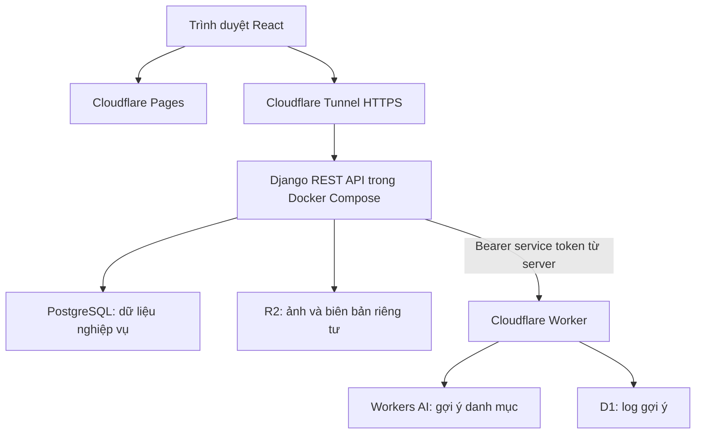
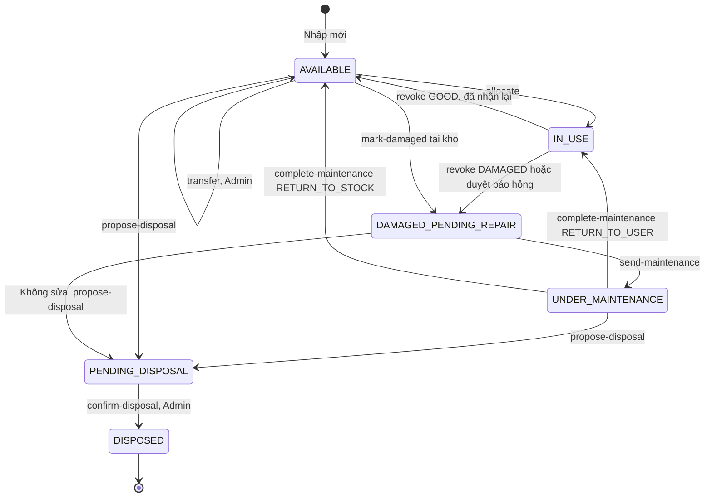

# Thiết kế hệ thống quản lý tài sản AssetHub

Ngày cập nhật: 2026-10-29. Trạng thái: thiết kế để triển khai, chưa phải bằng chứng ứng dụng đã hoạt động.

Kế hoạch thực hiện: [2026-10-29-assethub.md](../plans/2026-10-29-assethub.md).

## 1. Mục đích và phạm vi

AssetHub quản lý tài sản vật lý của một công ty nhỏ: máy tính, màn hình, máy in và thiết bị văn phòng. Phiên bản đầu bao gồm tài khoản, phòng ban, danh mục, hồ sơ tài sản, cấp phát, thu hồi, báo hỏng, bảo trì, điều chuyển, thanh lý và báo cáo.

Phân biệt yêu cầu từ ảnh bài tập với lựa chọn thiết kế:

| Nguồn | Nội dung |
| :--- | :--- |
| Bài tập | PostgreSQL, Django, React.js, đăng nhập/đăng ký, RBAC, Docker Compose, Swagger, Postman, biểu đồ; tìm hiểu công cụ kiểm thử bảo mật |
| Bài tập về Cloudflare | Triển khai lên Cloudflare, dùng gói Free; tìm hiểu Workers, D1, R2, cf CLI và Wrangler; gắn domain và tích hợp AI |
| Gợi ý trong bài tập | Workers AI là một lựa chọn cho phần AI |
| Lựa chọn của dự án | React trên Pages; Django/PostgreSQL trên máy demo qua Tunnel; R2 riêng tư; Worker + Workers AI gợi ý danh mục; D1 chỉ lưu log AI |

Không suy ra từ ảnh rằng Pages/Tunnel bắt buộc hoặc mọi thành phần phải chạy trong Workers. Cần xác nhận cách chấm phần triển khai với giảng viên (§12).

Không làm khấu hao, QR/camera, chatbot, đồng bộ PostgreSQL–D1 hoặc Manager quản lý nhiều phòng ban trong V1. Kho công ty được biểu diễn bằng `department_id = null`; kho phòng ban là tài sản thuộc phòng ban đó và chưa giao cho nhân viên.

## 2. Kiến trúc và điều kiện triển khai

- Django/PostgreSQL chạy ngoài Cloudflare. Tunnel chuyển tiếp đến Django, không lưu trữ hay thay thế backend. Máy demo phải bật, có mạng, Docker và `cloudflared` phải chạy.
- Local: Docker Compose có `db`, `backend`, `frontend`. Frontend dùng Vite; triển khai thật thì Pages phục vụ bản build React.
- PostgreSQL là nguồn dữ liệu nghiệp vụ duy nhất. D1 không chứa bản sao tài sản, nhân viên hoặc báo cáo công ty.
- Frontend gọi AI qua Django, không gọi Worker trực tiếp. Lỗi AI, D1 hoặc R2 không được làm gián đoạn thao tác quản lý không liên quan đến dịch vụ đó.
- Python 3.12, Django 5.2.x, DRF/SimpleJWT tương thích, PostgreSQL 16, React/Vite, Tailwind và Recharts. Task 0 xác minh tương thích và ghim phiên bản/lockfile; không cài các bản `latest` tùy ý vào môi trường đã khóa.
- Ngân sách mục tiêu: sử dụng hạn mức miễn phí và máy có sẵn. Không cam kết chi phí tuyệt đối bằng 0: domain, việc kích hoạt dịch vụ, hạn mức và điều kiện thanh toán phải được kiểm tra trên tài khoản thực tế. Không tự bật gói trả phí.

### 2.1. Đánh giá Cloudflare theo tài liệu hiện hành

Cloudflare có hướng dẫn chính thức chạy Django trong Python Workers qua WSGI/ASGI. Vì vậy, không dùng nhận định “Workers không hỗ trợ Django” hoặc suy đoán Django luôn vượt giới hạn tài nguyên để loại phương án này. Chạy Django trong Python Workers cũng không tương đương triển khai nguyên cụm Docker Compose.

Dự án chọn Hybrid để giữ môi trường Django/PostgreSQL/Docker thống nhất và giới hạn thay đổi trong bốn tuần. Chưa có thử nghiệm chứng minh toàn bộ phụ thuộc, driver PostgreSQL và migrations của ứng dụng tương thích với Python Workers. D1 là dịch vụ SQL dựa trên SQLite, không phải PostgreSQL và không tự thay thế database chính.

Nguồn đã đối chiếu ngày 2026-10-29:

- [Django trong Workers](https://developers.cloudflare.com/workers/languages/python/packages/django/).
- [Kết nối database từ Workers](https://developers.cloudflare.com/workers/databases/connecting-to-databases/).
- [Cloudflare Tunnel](https://developers.cloudflare.com/cloudflare-one/networks/connectors/cloudflare-tunnel/).
- [Pages headers](https://developers.cloudflare.com/pages/configuration/headers/).
- [Workers AI pricing](https://developers.cloudflare.com/workers-ai/platform/pricing/) và [R2 pricing](https://developers.cloudflare.com/r2/pricing/). Kiểm tra lại hạn mức khi triển khai.

## 3. Tài khoản, xác thực và phân quyền

### 3.1. Vòng đời tài khoản

- Đăng ký công khai: `username`, `password`, `full_name`, `email`, `phone` tùy chọn. Server cố định `role=USER`, `is_active=false`, `department=null`; trả 201 với thông báo chờ Admin kích hoạt, không trả JWT. Gửi thêm `role`, `department`, `is_active` hoặc trường ngoài danh sách cho phép phải trả 400.
- Admin kiểm tra người đăng ký, gán phòng ban và kích hoạt. Manager/User đang hoạt động bắt buộc có một phòng ban. Admin có thể không thuộc phòng ban.
- Admin tạo/sửa tài khoản qua API quản trị; không xóa cứng tài khoản. Không khóa/hạ quyền Admin đang hoạt động cuối cùng.
- Chặn đổi phòng ban hoặc vô hiệu hóa tài khoản đang giữ tài sản hay có phiếu chờ; trả 409 và yêu cầu xử lý tài sản/phiếu trước. Lịch sử đã ghi không đổi khi hồ sơ thay đổi.
- JWT access 10 phút, refresh 1 ngày. Đổi mật khẩu phải xác minh mật khẩu cũ và áp dụng password validators. Frontend chỉ lưu token trong bộ nhớ; tải lại trang cần đăng nhập lại trong V1. Không đưa token, mật khẩu hoặc secret vào log.
- `auth_version` trên User và trong cả hai token: backend kiểm tra version và `is_active` khi xác thực access và refresh. Đổi mật khẩu, đổi vai trò/phòng ban, vô hiệu hóa hoặc logout tăng version, làm mất hiệu lực cả token cũ. Logout áp dụng cho mọi phiên của tài khoản, ghi rõ trên giao diện. Refresh phải kiểm tra database, không chỉ chữ ký token. Quyền lấy từ database, không tin `role` do client gửi.
- Làm mới token một lần khi access hết hạn; các request đồng thời dùng chung một lần refresh. Refresh thất bại thì xóa phiên và về đăng nhập.

### 3.2. Ma trận quyền

| Hành động | Admin | Manager | User |
| :--- | :--- | :--- | :--- |
| Xem/sửa hồ sơ, đổi mật khẩu | Chính mình | Chính mình | Chính mình |
| Tài khoản, vai trò, kích hoạt | Toàn công ty | Chỉ đọc nhân viên cùng phòng ban | Không |
| Phòng ban | Tạo/sửa, xem tất cả | Chỉ đọc phòng mình | Chỉ đọc phòng mình |
| Danh mục tài sản | Tạo/sửa, xem | Chỉ đọc | Chỉ đọc |
| Tạo/sửa hồ sơ tài sản | Có | Không | Không |
| Đọc tài sản | Toàn công ty | Phòng mình | Đang được giao cho mình |
| Cấp phát/thu hồi/xác nhận hỏng/bảo trì/đề xuất thanh lý | Toàn công ty | Phòng mình | Gửi phiếu cá nhân |
| Điều chuyển phòng ban, xác nhận thanh lý | Có | Không | Không |
| Duyệt/từ chối phiếu | Toàn công ty | Phòng mình | Không |
| Báo cáo | Toàn công ty | Phòng mình | Không; dùng cổng cá nhân |
| Gợi ý AI khi tạo tài sản | Có | Không | Không |

Danh mục/phòng ban đã được tham chiếu không xóa cứng; V1 chỉ tạo và cập nhật. Dùng FK `PROTECT` cho dữ liệu lịch sử cần giữ. Permission và queryset đều kiểm tra ở Django cho list, detail, action, lịch sử, file, báo cáo và các FK đầu vào. Truy cập ngoài phạm vi trả 404; vai trò không có quyền hành động trả 403. Chưa xác thực trả 401.

## 4. Mô hình dữ liệu

| Model | Trường chính |
| :--- | :--- |
| Department | `id`, `name`, `code` unique, `description`, `created_at` |
| User (AbstractUser) | Trường Django tiêu chuẩn gồm password đã hash; thêm `full_name`, `phone`, `role`, `department`, `auth_version`, `created_at`; username unique, email bắt buộc |
| Category | `id`, `name` unique, `description`, `created_at` |
| Asset | `id`, `asset_code` unique bất biến, `name`, `category`, `serial_number`, `specification`, `status`, `department` nullable, `assigned_to_user` nullable, `image`, `document`, `purchase_date`, `created_at`, `updated_at` |
| AssetRequest | `id`, `request_code` unique bất biến, `request_type`, `requester`, `asset` nullable với ALLOCATE, `requested_category` bắt buộc với ALLOCATE, `department` snapshot khi tạo, `reason`, `status`, `reviewed_by`, `reviewed_at`, `rejection_reason`, `created_at` |
| AssetHistoryLog | `id`, `asset`, `actor`, `action_type`, `from_status`, `to_status`, `from_user`, `to_user`, `from_department`, `to_department`, `reason`, `asset_code_snapshot`, `asset_name_snapshot`, `created_at` |
| IdentifierSequence | `kind` (AST/REQ), `year`, `value`; unique `(kind, year)`, tăng trong giao dịch |

- `image`/`document` lưu object key của storage; không lưu presigned URL sẽ hết hạn vào database. URL tải được tạo sau khi kiểm tra quyền.
- `AST-YYYY-NNN` và `REQ-YYYY-NNN`: NNN tối thiểu ba chữ số, cho phép 1000 trở lên. Sinh phía server bằng bộ đếm có khóa và unique constraint; không dùng `count()+1` hoặc `max()+1` không khóa. Xử lý tranh chấp khi tạo dòng bộ đếm lần đầu bằng unique constraint/retry có giới hạn.
- Tài sản mới luôn `AVAILABLE`, chưa có người giữ; chỉ Admin chọn phòng ban hoặc kho công ty. Không xóa cứng tài sản và lịch sử. Lịch sử chỉ được tạo qua service, không có API cập nhật/xóa.
- `AVAILABLE`, `PENDING_DISPOSAL`, `DISPOSED` không có người giữ. `IN_USE` bắt buộc có người giữ đang hoạt động, cùng phòng ban với tài sản. Tài sản chưa phân bổ không được có người giữ.
- Tài sản hỏng/bảo trì có thể giữ người chịu trách nhiệm ban đầu để bàn giao lại; không cấp cho người khác trong hai trạng thái này. Khi về kho, xóa người giữ trong cùng giao dịch và ghi log.
- Trạng thái phiếu: `PENDING`, `APPROVED`, `REJECTED`. Requester, department, status, reviewer là trường server quản lý. V1 không có sửa/xóa phiếu sau khi gửi.

## 5. Máy trạng thái và các thao tác nghiệp vụ

Trạng thái: `AVAILABLE`, `IN_USE`, `DAMAGED_PENDING_REPAIR`, `UNDER_MAINTENANCE`, `PENDING_DISPOSAL`, `DISPOSED`.

Tất cả action nhận `reason` không rỗng. Manager chỉ thao tác trong phòng mình, Admin được thao tác toàn công ty trừ khi điều kiện nghiệp vụ không đạt.

| POST `/api/assets/{id}/…/` | Input bổ sung và điều kiện | Kết quả |
| :--- | :--- | :--- |
| `allocate` | `assigned_to_user_id`; tài sản AVAILABLE đã phân phòng; người nhận active và cùng phòng | IN_USE, gán người nhận |
| `revoke` | `received_confirmed=true`, `condition=GOOD\|DAMAGED`; tài sản IN_USE | AVAILABLE hoặc DAMAGED_PENDING_REPAIR; xóa người giữ |
| `mark-damaged` | Tài sản AVAILABLE; báo hỏng khi đang dùng phải qua phiếu DAMAGE_REPORT | DAMAGED_PENDING_REPAIR |
| `send-maintenance` | Chỉ DAMAGED_PENDING_REPAIR | UNDER_MAINTENANCE, giữ người chịu trách nhiệm nếu có |
| `complete-maintenance` | Chỉ UNDER_MAINTENANCE; `result=RETURN_TO_USER\|RETURN_TO_STOCK`; trả người cũ phải còn active và cùng phòng | IN_USE giữ người cũ; hoặc AVAILABLE và xóa người giữ |
| `transfer` | Admin; AVAILABLE, không có người giữ; `to_department_id` là phòng khác hoặc null để về kho công ty | Giữ AVAILABLE, cập nhật phòng ban và ghi TRANSFER |
| `propose-disposal` | AVAILABLE, DAMAGED_PENDING_REPAIR hoặc UNDER_MAINTENANCE; nếu đang có người chịu trách nhiệm phải `received_confirmed=true` | PENDING_DISPOSAL, xóa người giữ và ghi đầy đủ trước/sau |
| `confirm-disposal` | Admin; chỉ PENDING_DISPOSAL | DISPOSED, không có chuyển tiếp khác |

V1 không có hủy đề xuất thanh lý. Chọn sai/thiếu input trả 400; trạng thái đã thay đổi hoặc xung đột thao tác trả 409. `PATCH /api/assets/{id}/` chỉ Admin và chỉ cho `name`, `category`, `serial_number`, `specification`, `purchase_date`; gửi `status`, `department`, `assigned_to_user`, `asset_code`, thời gian hoặc trường ngoài allowlist trả 400. `POST` tạo tài sản không cho client chỉ định trạng thái/người giữ/mã. DISPOSED chỉ đọc, không sửa hồ sơ/upload mới; vẫn xem hồ sơ và file cũ theo phạm vi quyền.

### 5.1. Giao dịch, khóa và lịch sử

- Mọi action chạy trong `transaction.atomic()`. Đọc lại Asset bằng `select_for_update()`, kiểm tra quyền, trạng thái và người nhận trên bản ghi đã khóa rồi mới cập nhật.
- Duyệt/từ chối phiếu: khóa AssetRequest trước, kiểm tra còn PENDING, sau đó khóa Asset. Giữ thứ tự khóa này ở mọi đường xử lý có cả phiếu và tài sản. Nếu thao tác nhiều tài sản thì khóa theo id tăng dần.
- Các đường trực tiếp và qua phiếu dùng chung service và quy tắc. Tài sản, phiếu và log cùng commit hoặc cùng rollback. Không gọi AI/R2 trong giao dịch khóa tài sản.
- Cấp phát đồng thời một tài sản cho hai người: một request thành công, request còn lại 409; không phát sinh hai log ALLOCATE. Duyệt/từ chối lại phiếu đã xử lý trả 409, không thay đổi gì.
- Mỗi action thành công ghi một log (kể cả TRANSFER không đổi trạng thái). Tạo qua API có log CREATE. Lỗi/không có thay đổi không ghi log. Log ghi actor, thời điểm server, lý do và đầy đủ giá trị trước/sau, không dùng middleware để suy đoán nghiệp vụ.

## 6. Phiếu cấp phát, trả và báo hỏng

`POST /api/requests/` và `GET /api/requests/`; `GET /api/requests/{id}/` theo cùng phạm vi. User chỉ tạo và xem phiếu của mình; Manager xem/xử lý phòng mình; Admin toàn công ty. Không cho client giả requester/phòng ban/người duyệt/trạng thái.

| Loại | Khi User gửi | Khi Manager/Admin duyệt `POST /api/requests/{id}/approve/` |
| :--- | :--- | :--- |
| ALLOCATE | `requested_category_id`, `reason`; client không gửi `asset_id`, tài sản do reviewer chọn | Bắt buộc `selected_asset_id`; phải AVAILABLE, đúng loại và phòng ban của phiếu; cấp cho chính requester, ghi asset vào phiếu |
| RETURN | `asset_id`, `reason`; phải đang IN_USE và giao cho requester | Bắt buộc `received_confirmed=true`, `condition=GOOD\|DAMAGED`; xử lý như revoke |
| DAMAGE_REPORT | `asset_id`, `reason`; phải đang IN_USE và giao cho requester | Chỉ xác nhận khi tài sản vẫn IN_USE và vẫn giao cho requester; chuyển DAMAGED_PENDING_REPAIR, giữ người chịu trách nhiệm |

- Kiểm tra quyền sở hữu, trạng thái, requester active và phòng ban khớp cả lúc tạo lẫn lúc duyệt. Tài sản đã đổi người giữ/phòng ban thì trả 409, phiếu vẫn PENDING để reviewer từ chối kèm lý do.
- Chỉ tạo phiếu không thay đổi tài sản. Chỉ chặn phiếu PENDING trùng `(requester, request_type, asset)` cho RETURN/DAMAGE_REPORT; ALLOCATE cho phép nhiều phiếu với lý do khác nhau. Dùng database constraint phù hợp cho trường hợp trùng.
- `POST /api/requests/{id}/reject/` yêu cầu `rejection_reason` không rỗng; chỉ cập nhật phiếu PENDING, không đổi tài sản. Không có yêu cầu bắt buộc reviewer khác requester trong V1 vì chỉ User tạo phiếu.

## 7. Lịch sử cá nhân và báo cáo

### 7.1. Hai cách xem lịch sử

- `GET /api/assets/{id}/history/`: Admin hoặc Manager đúng phòng tài sản hiện tại; User không có quyền. Dùng cho timeline quản trị.
- `GET /api/me/asset-history/`: tài khoản xem sự kiện có `from_user=self` hoặc `to_user=self`, kể cả tài sản đã trả/đã điều chuyển/đã thanh lý. Trả trường an toàn: mã/tên tài sản snapshot, loại thao tác, trạng thái trước/sau, thời điểm và thông điệp do server tạo về việc giao/thu hồi của chính người xem. Không trả thông tin người khác, lý do tự do có thể chứa thông tin cá nhân hoặc toàn bộ lịch sử tài sản.
- `GET /api/assets/` của User chỉ liệt kê tài sản hiện đang được giao; không dùng queryset này để tính lịch sử cá nhân. Endpoint cá nhân có phân trang và không cho chọn user khác.

### 7.2. Dashboard

Admin/Manager dùng `GET /api/reports/kpis/` và `/api/reports/charts/`. User nhận 403. Backend áp dụng scope trước khi aggregate; Manager gửi bộ lọc phòng khác nhận 403.

- Sáu thẻ: `total_active` (khác DISPOSED), `available`, `in_use`, `damaged_under_maintenance`, `pending_disposal`, `pending_requests`; có `last_updated`.
- Bốn biểu đồ: tỷ lệ trạng thái, số lượng theo danh mục, số lượng theo phòng ban (Admin-only, có “Chưa phân bổ”), nhập mới/thanh lý theo tháng. Manager không nhận `department_distribution` của công ty; trả mảng rỗng cho trường đó và UI ẩn biểu đồ.
- Các biểu đồ hiện trạng đều loại DISPOSED. Mỗi tài sản đếm một lần theo id/mã, không theo số log hay số lượt cấp phát.
- Lọc `category_id` cho số liệu tài sản và phiếu theo loại được yêu cầu/tài sản liên quan; `department_id` chỉ Admin, gồm giá trị `unallocated` cho kho công ty. Phiếu không có phòng ban null nên số phiếu ở kho công ty bằng 0.
- `start_month`, `end_month` định dạng YYYY-MM chỉ áp dụng biểu đồ biến động, tối đa 12 tháng liên tiếp; mặc định 12 tháng gồm tháng hiện tại. Bù tháng không phát sinh bằng 0; lỗi khoảng thời gian trả 400.
- Tháng thống kê theo Asia/Bangkok, database lưu thời gian UTC. Nhập mới dùng CREATE log, thanh lý dùng DISPOSAL_CONFIRM log; phòng ban lịch sử dùng snapshot `to_department` trong log, không dùng phòng ban hiện tại của tài sản. Bộ lọc danh mục dùng danh mục hiện tại, ghi rõ ý nghĩa trên báo cáo V1.

## 8. File và Cloudflare R2

- R2 bucket riêng tư cho cả ảnh và biên bản, không xuất URL công khai. R2 credentials chỉ ở backend. Local/test dùng storage tạm riêng, không kết nối R2 thật.
- `POST /api/assets/{id}/attachments/`: Admin upload multipart, `kind=image|document`, `file`; tối đa 5 MiB/ảnh (JPEG/PNG/WebP), 10 MiB/PDF. Kiểm tra nội dung thực, không chỉ extension/MIME khai báo; tên object do server tạo, không tin đường dẫn từ client.
- `GET /api/assets/{id}/attachments/{kind}/download/`: kiểm tra quyền đọc Asset rồi trả URL ký hết hạn 60 giây, document tải dưới dạng attachment. Link đã cấp có thể dùng đến khi hết hạn; thay đổi quyền không thu hồi tức thì link đó. Response chứa URL đặt `Cache-Control: no-store`.
- User chỉ tải file của tài sản đang được giao; lịch sử cá nhân không cấp quyền tải biên bản cũ. Manager giới hạn phòng mình. Không cho client cung cấp object key bất kỳ để lấy URL ký.
- Upload lỗi trả 503, giữ tham chiếu file cũ; không báo lưu thành công. Lưu tham chiếu mới sau upload thành công; dọn object mồ côi theo thao tác bù nếu database lỗi. Thay file thành công chỉ dọn file cũ sau commit.
- Nếu cấu hình R2 ở môi trường triển khai bị thiếu/lỗi thì báo lỗi rõ; chỉ fallback local ở chế độ local/test, không âm thầm đổi storage khi demo.

## 9. AI và Cloudflare D1

### 9.1. Hợp đồng và bảo vệ endpoint

- React Admin gọi `POST /api/ai/suggest-category/` với `{name, description}` và access JWT. Django xác thực Admin, đọc danh mục đang có và gửi đến Worker `POST /api/suggest-category` với `{request_id, name, description, categories:[{id,name}]}`.
- Worker bắt buộc `Authorization: Bearer <AI_SERVICE_TOKEN>` do Django thêm. Token ở backend env và Wrangler secret; không xuất trong biến `VITE_*`, source frontend, response hay log. Thiếu/sai token trả 401 và không gọi AI/D1. Worker không phục vụ CORS cho trình duyệt; CORS không thay thế xác thực.
- Django throttle Admin 10 lần/phút theo user, giới hạn name 200 ký tự, description 2000 ký tự; Worker kiểm tra method/path, body tối đa 16 KiB, tối đa 100 danh mục. Không tự động retry AI để tránh tăng lượt dùng. Throttle DRF chỉ là giới hạn phục vụ demo, không phải cam kết hạn mức thanh toán tuyệt đối.
- `AI_MODEL` cấu hình trong Worker. Trước deploy kiểm tra model text-generation hiện có, quyền truy cập và hạn mức; ghi model thực dùng trong deployment guide. Không cố định một model cũ mà chưa kiểm tra khả dụng.
- Prompt yêu cầu chọn trong danh sách; validate output JSON và category id thuộc allowlist, giới hạn explanation 500 ký tự và output model tối đa 256 tokens. Không coi tên/mô tả là lệnh thực thi. Không trả “độ tin cậy” chưa được hiệu chuẩn.
- Thành công trả `{request_id, suggested_category_id, explanation, log_saved}`. Django kiểm tra lại category id còn tồn tại. Gợi ý không tự ghi tài sản; Admin bấm áp dụng trước khi lưu form.

### 9.2. Chịu lỗi và log

- Worker đặt thời hạn xử lý AI 5 giây; Django timeout 6 giây, frontend 8 giây. Nếu runtime không hủy được inference đã bắt đầu thì dừng chờ phản hồi, không tuyên bố đã ngừng tính phí. Hết quota/timeout/output sai trả lỗi có mã máy đọc, Django ánh xạ thành 503; throttle của Django trả 429.
- UI giữ nguyên form, hiển thị “Dịch vụ AI tạm thời không khả dụng, vui lòng chọn thủ công”, không tự gửi lại. Chọn tay, tạo/sửa/cấp phát và báo cáo không gọi AI.
- D1 `ai_suggestion_logs`: `id` request UUID unique, `asset_name`, `description`, `suggested_category_id`, `suggested_category_name`, `model`, `created_at`. Không lưu JWT/service token/dữ liệu nhân viên. Không có trường `user_accepted` khi chưa làm luồng phản hồi xác nhận.
- AI thành công nhưng D1 lỗi: vẫn trả gợi ý `log_saved=false`, log kỹ thuật đã che secret; không biến lỗi ghi log thành lỗi nghiệp vụ. AI thất bại không bịa gợi ý thành công.

## 10. Giao diện và triển khai

- Auth: Login, Register với thông báo chờ kích hoạt, Profile, đổi mật khẩu, logout mọi phiên.
- Admin: trang tài khoản (lọc chờ kích hoạt), phòng ban, danh mục; tài sản có form tạo/sửa, upload, action vòng đời và xử lý phiếu; báo cáo, gợi ý AI.
- Manager: tài sản/nhân viên phòng mình, action vòng đời được phép, hộp thư duyệt phiếu, báo cáo phòng mình. Không có nút tạo tài sản, điều chuyển hoặc xác nhận thanh lý.
- User: tài sản hiện tại, lịch sử cá nhân riêng, gửi/theo dõi phiếu; không truy cập trang báo cáo công ty.
- Có trạng thái loading, rỗng, lỗi, phân trang, xác nhận action và chống bấm lặp. API từ chối vẫn được hiển thị đúng dù nút đã ẩn theo quyền.
- Vite đặt headers tại `frontend/public/_headers`; build phải tạo `frontend/dist/_headers`. CSP `connect-src` cho đúng API origin; không đặt secret trong build. SPA truy cập trực tiếp route phải hoạt động trên Pages.
- CORS cấu hình ở Django cho đúng Pages/custom domain và local dev khi DEBUG; hỗ trợ preflight Authorization. Không dùng Pages headers để sửa CORS của API Django. JWT dùng Authorization header, không cookie trong V1; không bật credentials CORS không cần thiết.
- Production: `DEBUG=false`, `ALLOWED_HOSTS` cụ thể, cấu hình proxy HTTPS đúng đường Tunnel; dùng Gunicorn, không runserver. PostgreSQL không publish port ra Internet. Có healthcheck db/backend và named volume dữ liệu.
- Compose base chỉ có db/backend, không public port và không bind mount source. Dev override mở backend localhost, mount `./backend:/app` để migrations/schema/code thay đổi được lưu về workspace, thêm frontend dev. Mọi test local chạy trên cấu hình dev này.
- Compose production là override của base, không ghép dev override; lệnh chuẩn từ root: `docker compose -p assethub-demo --env-file .env.demo -f docker-compose.yml -f deploy/docker-compose.prod.yml ...`. Project demo có volume/network riêng với local để không ghi đè database đang phát triển. Override thêm cloudflared, không có frontend dev/source bind mount/cổng backend public. Mọi bind path giải theo compose gốc và kiểm tra bằng `config`; `.env.demo` không commit.
- `.env.example` chỉ placeholder, `.gitignore` bỏ `.env`, tunnel credentials, test reports chứa token và file media. TLS secret/token mount chỉ đọc hoặc inject env, không commit.

## 11. Kiểm chứng và lịch thực hiện

Không đánh dấu task hoàn tất chỉ vì đã viết tài liệu hoặc test có tên. Kế hoạch phải chỉ ra cách chạy và điều kiện đạt; kết quả thực chạy lưu trong verification report, không có secret.

| Tuần | Kết quả cần đạt |
| :--- | :--- |
| 1 | Task 0–3: môi trường tái lập, đăng ký/JWT, quản trị cơ bản, dữ liệu và quy tắc bảo vệ |
| 2 | Task 4–7: state machine, phiếu, cạnh tranh dữ liệu, lịch sử cá nhân, báo cáo, Postman |
| 3 | Task 8–10: React hoàn chỉnh cho ba vai trò và R2 |
| 4 | Task 11–13: AI/D1, Cloudflare, kiểm thử đầu cuối và tài liệu demo |

Seed dùng lệnh `seed_data --demo`, tạo 1 Admin, 2 Manager, 4 User, 2 phòng ban, 5 danh mục và 15 tài sản với log nhất quán, gồm các tháng không có dữ liệu để kiểm thử biểu đồ. Mật khẩu demo lấy từ env `DEMO_SEED_PASSWORD`, không ghi mật khẩu mặc định công khai. Lệnh idempotent, không reset mật khẩu/dữ liệu đã có; chỉ chạy khi `ALLOW_DEMO_SEED=true` được chủ động bật cho môi trường demo.

| Yêu cầu | Task trong kế hoạch | Bằng chứng bắt buộc |
| :--- | :--- | :--- |
| Bootstrap/versions/migrations | 0, 1 | Compose từ database rỗng; lockfiles, pytest config |
| Đăng ký, JWT, thu hồi phiên, profile | 1, 8 | Test token thật, tài khoản pending, chặn tự nâng quyền |
| Tài khoản/phòng ban/danh mục | 2, 8 | Test Admin, scope Manager, màn hình CRUD được phép |
| Hồ sơ tài sản, allowlist, seed | 3, 9 | API tests, seed hai lần không nhân bản |
| Chuyển trạng thái và lịch sử | 4 | Test mọi cạnh hợp lệ và cạnh sai, snapshot log |
| Phiếu và cạnh tranh | 5 | Transaction tests trên PostgreSQL, rollback và 409 |
| Lịch sử cá nhân và báo cáo | 6, 9 | Test sau thu hồi/điều chuyển; scope và số liệu tháng |
| Swagger/Postman | 7, 13 | Schema validate và Newman assertions thực chạy |
| React ba vai trò | 8, 9, 13 | Vitest integration và Playwright flow |
| R2 riêng tư, quyền file | 10, 13 | Unit/mock + kiểm chứng upload/download R2 thật |
| AI/Worker/D1 | 11, 13 | Xác thực, lỗi/quota/timeout/output sai, kiểm chứng log D1 |
| Pages/Tunnel/domain | 12, 13 | dist headers, CORS thực tế, compose up, truy cập 4G |
| Kiểm thử bảo mật bài tập | 13 | Biên bản thử công cụ trên môi trường sở hữu; phát hiện, sửa và kiểm lại |

## 12. Điểm cần xác nhận và giới hạn kết luận

1. Giảng viên chấp nhận backend Docker ngoài Cloudflare qua Tunnel hay yêu cầu backend thực sự host trên Cloudflare? Tiếp tục triển khai local trong khi chờ; chưa tuyên bố đạt tiêu chí triển khai.
2. Demo chạy máy cá nhân hay cần trực tuyến liên tục? Nếu cần liên tục, chọn host và ngân sách riêng trước khi triển khai.
3. Đã có domain thuộc quyền quản lý và quyền đổi DNS chưa? Free tier không đồng nghĩa được cấp domain miễn phí.
4. D1/R2/Workers phải tích hợp vào sản phẩm hay chỉ thực hành riêng? Thiết kế hiện tích hợp cả ba; AI là gợi ý danh mục văn bản, cần xác nhận đáp ứng tiêu chí AI.
5. Tài khoản Cloudflare có kích hoạt được R2/AI trong ngân sách đã thống nhất không? Nếu chưa, local mocks chỉ chứng minh phần mềm, không chứng minh tích hợp thật.

Đánh giá độ bao phủ dựa trên bảng yêu cầu và bằng chứng thực tế; không tự kết luận “đạt đầy đủ yêu cầu giảng viên” trước khi xác nhận các điểm này và hoàn thành kiểm chứng.
