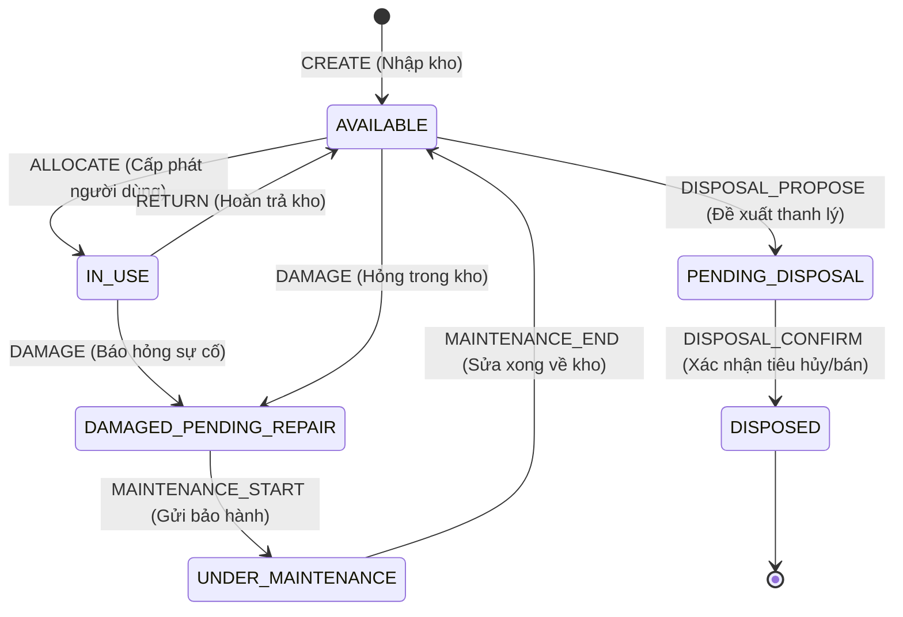

# Tài Liệu Đặc Tả Bộ Dữ Liệu Mô Phỏng Doanh Nghiệp Việt Nam - AssetHub

> [!IMPORTANT]
> **TUYÊN BỐ DỮ LIỆU MÔ PHỎNG (SIMULATION DATA DISCLAIMER)**:
> Toàn bộ dữ liệu trong bộ tài liệu và fixture này (bao gồm tên doanh nghiệp, họ tên nhân sự, các địa chỉ email dạng `assethub.demo.<username>@gmail.com`, số điện thoại di động, mã số serial phần cứng và lý do yêu cầu) là **dữ liệu mô phỏng giả lập nội bộ** phục vụ cho mục đích phát triển, kiểm thử tự động (e2e, integration), đào tạo người dùng và trình diễn tính năng (demo) trên hệ thống AssetHub.
> - Các địa chỉ email `@gmail.com` trong bộ dữ liệu chưa được xác thực bên ngoài và hệ thống **tuyệt đối không gửi email thực tế ra bên ngoài**.
> - Mọi sự trùng hợp ngẫu nhiên về tên người, số điện thoại hoặc mã định danh với thực tế bên ngoài đều không thuộc chủ ý của đội ngũ phát triển.

---

## 1. Bối Cảnh Doanh Nghiệp Mô Phỏng

- **Tên doanh nghiệp**: Công ty Cổ phần Công nghệ & Dịch vụ Số AssetHub Việt Nam (*AssetHub Tech Services Vietnam JSC*)
- **Mã số thuế**: `0109887766`
- **Trụ sở chính (Headquarters)**: Tầng 12, Tòa nhà Keangnam Landmark 72, Đường Phạm Hùng, Phường Mễ Trì, Quận Nam Từ Liêm, TP. Hà Nội
- **Chi nhánh miền Nam (Southern Branch)**: Tầng 8, Tòa nhà Bitexco Financial Tower, Số 2 Hải Triều, Phường Bến Nghé, Quận 1, TP. Hồ Chí Minh
- **Lĩnh vực hoạt động**: Tư vấn chuyển đổi số doanh nghiệp, phát triển giải pháp SaaS quản lý tài sản thông minh, triển khai hạ tầng điện toán đám mây và dịch vụ thương mại điện tử B2B.
- **Quy mô nhân sự**: Doanh nghiệp vừa và nhỏ (SME) với quy mô tổng thể khoảng 60 - 80 nhân sự; trong đó **35 nhân sự chủ chốt** đại diện cho toàn bộ các phòng ban chức năng được thiết lập tài khoản mẫu chuẩn hóa trong hệ thống AssetHub.

---

## 2. Cơ Cấu Tổ Chức & 8 Phòng Ban Chức Năng

Doanh nghiệp được tổ chức theo mô hình phòng ban chức năng tập trung với 8 đơn vị nòng cốt:

| STT | Mã PB (`code`) | Tên Phòng Ban | Vai Trò & Chức Năng Chính | Quản Lý Phụ Trách (`Manager`) |
| :---: | :---: | :--- | :--- | :--- |
| 1 | `BGD` | **Ban Giám Đốc** | Lãnh đạo và định hướng chiến lược hoạt động toàn diện của doanh nghiệp | Trần Quang Hải (`gd.tran`) |
| 2 | `NSHC` | **Phòng Nhân sự - Hành chính** | Quản lý tuyển dụng, đào tạo, chế độ chính sách và vận hành hành chính văn phòng | Lê Thị Ngọc Mai (`tp.nhansu`) |
| 3 | `TCKT` | **Phòng Tài chính - Kế toán** | Quản lý dòng tiền, hạch toán kế toán, quản trị tài chính và báo cáo thuế | Nguyễn Văn Minh (`tp.ketoan`) |
| 4 | `CNTT` | **Phòng Công nghệ thông tin** | Phát triển phần mềm, hạ tầng máy chủ mạng, an toàn thông tin và hỗ trợ kỹ thuật CNTT | Hoàng Đình Tuấn (`tp.it`) |
| 5 | `KD` | **Phòng Kinh doanh** | Phát triển thị trường, bán hàng B2B/B2C, chăm sóc đối tác và mở rộng kênh phân phối | Phạm Quốc Bảo (`tp.kinhdoanh`) |
| 6 | `MKT` | **Phòng Tiếp thị - Marketing** | Xây dựng thương hiệu, chiến dịch tiếp thị số, truyền thông đa kênh và thiết kế sáng tạo | Đặng Thùy Dương (`tp.marketing`) |
| 7 | `VH` | **Phòng Vận hành** | Quản lý quy trình dịch vụ, kiểm soát chất lượng vận hành và tối ưu hiệu suất hoạt động | Bùi Hữu Thịnh (`tp.vanhanh`) |
| 8 | `KV` | **Phòng Kho vận & Hậu cần** | Quản lý kho hàng hóa, kiểm soát tài sản vật tư và điều phối chuỗi cung ứng giao nhận | Võ Văn Đạt (`tp.khovan`) |

---

## 3. Danh Sách 35 Tài Khoản Người Dùng Mẫu (User Accounts)

Hệ thống RBAC phân quyền trên AssetHub phân tách rõ 3 vai trò:
- **ADMIN (2 tài khoản)**: Toàn quyền quản trị hệ thống, danh mục, phân bổ liên phòng ban, cấu hình và phê duyệt cấp cao.
- **MANAGER (8 tài khoản)**: Trưởng phòng các đơn vị, quản lý tài sản nội bộ phòng ban, duyệt yêu cầu ALLOCATE/RETURN/DAMAGE của nhân viên thuộc phòng.
- **USER (25 tài khoản)**: Nhân viên các phòng ban, người trực tiếp nắm giữ và sử dụng tài sản, gửi yêu cầu cấp phát, hoàn trả và báo hỏng.

> [!NOTE]
> **Mật khẩu khởi tạo chuẩn**: Khi chạy script seed mẫu, mật khẩu đăng nhập mặc định được cấp qua biến môi trường `DEMO_SEED_PASSWORD` (ví dụ: `Demo@2026!` hoặc `admin123`). Tài khoản đã tồn tại trong DB không bị ghi đè mật khẩu.

| STT | Username | Họ và Tên | Vai Trò (`Role`) | Phòng Ban | Email Mô Phỏng | Số Điện Thoại | Ghi Chú |
| :---: | :--- | :--- | :---: | :---: | :--- | :---: | :--- |
| 1 | `admin` | **System Administrator** | `ADMIN` | *Toàn hệ thống* | `admin@assethub.local` | `0901234567` | Quản trị viên tối cao (tài khoản hiện có) |
| 2 | `admin_phu` | **Vũ Hoàng Long** | `ADMIN` | *Toàn hệ thống* | `assethub.demo.admin_phu@gmail.com` | `0908889999` | Quản trị viên phụ trách hạ tầng |
| 3 | `gd.tran` | **Trần Quang Hải** | `MANAGER` | `BGD` | `assethub.demo.gd.tran@gmail.com` | `0912111222` | Trưởng phòng BGD |
| 4 | `tp.nhansu` | **Lê Thị Ngọc Mai** | `MANAGER` | `NSHC` | `assethub.demo.tp.nhansu@gmail.com` | `0913222333` | Trưởng phòng NSHC |
| 5 | `tp.ketoan` | **Nguyễn Văn Minh** | `MANAGER` | `TCKT` | `assethub.demo.tp.ketoan@gmail.com` | `0914333444` | Trưởng phòng TCKT |
| 6 | `tp.it` | **Hoàng Đình Tuấn** | `MANAGER` | `CNTT` | `assethub.demo.tp.it@gmail.com` | `0915444555` | Trưởng phòng CNTT |
| 7 | `tp.kinhdoanh` | **Phạm Quốc Bảo** | `MANAGER` | `KD` | `assethub.demo.tp.kinhdoanh@gmail.com` | `0916555666` | Trưởng phòng KD |
| 8 | `tp.marketing` | **Đặng Thùy Dương** | `MANAGER` | `MKT` | `assethub.demo.tp.marketing@gmail.com` | `0917666777` | Trưởng phòng MKT |
| 9 | `tp.vanhanh` | **Bùi Hữu Thịnh** | `MANAGER` | `VH` | `assethub.demo.tp.vanhanh@gmail.com` | `0918777888` | Trưởng phòng VH |
| 10 | `tp.khovan` | **Võ Văn Đạt** | `MANAGER` | `KV` | `assethub.demo.tp.khovan@gmail.com` | `0919888999` | Trưởng phòng KV |
| 11 | `truong` | **Nguyễn Phan Ngọc Trưởng** | `USER` | `CNTT` | `hnhoa494@gmail.comhnhoa` | `0325581101` | Kỹ sư phần mềm core (tài khoản hiện có) |
| 12 | `tk.linh` | **Trịnh Diệu Linh** | `USER` | `BGD` | `assethub.demo.tk.linh@gmail.com` | `0981010001` | Nhân viên BGD |
| 13 | `ns.huong` | **Đỗ Thu Hương** | `USER` | `NSHC` | `assethub.demo.ns.huong@gmail.com` | `0982020002` | Nhân viên NSHC |
| 14 | `ns.thanh` | **Phan Tiến Thành** | `USER` | `NSHC` | `assethub.demo.ns.thanh@gmail.com` | `0982020003` | Nhân viên NSHC |
| 15 | `hc.hoa` | **Vũ Quỳnh Hoa** | `USER` | `NSHC` | `assethub.demo.hc.hoa@gmail.com` | `0982020004` | Nhân viên NSHC |
| 16 | `kt.anh` | **Ngô Phương Anh** | `USER` | `TCKT` | `assethub.demo.kt.anh@gmail.com` | `0983030005` | Nhân viên TCKT |
| 17 | `kt.duc` | **Hoàng Trọng Đức** | `USER` | `TCKT` | `assethub.demo.kt.duc@gmail.com` | `0983030006` | Nhân viên TCKT |
| 18 | `kt.thao` | **Chu Thu Thảo** | `USER` | `TCKT` | `assethub.demo.kt.thao@gmail.com` | `0983030007` | Nhân viên TCKT |
| 19 | `it.nam` | **Lê Hoàng Nam** | `USER` | `CNTT` | `assethub.demo.it.nam@gmail.com` | `0984040008` | Nhân viên CNTT |
| 20 | `it.tuan` | **Phạm Minh Tuấn** | `USER` | `CNTT` | `assethub.demo.it.tuan@gmail.com` | `0984040009` | Nhân viên CNTT |
| 21 | `it.yen` | **Dương Hải Yến** | `USER` | `CNTT` | `assethub.demo.it.yen@gmail.com` | `0984040010` | Nhân viên CNTT |
| 22 | `it.son` | **Đinh Thái Sơn** | `USER` | `CNTT` | `assethub.demo.it.son@gmail.com` | `0984040011` | Nhân viên CNTT |
| 23 | `kd.an` | **Nguyễn Văn An** | `USER` | `KD` | `assethub.demo.kd.an@gmail.com` | `0985050012` | Nhân viên KD |
| 24 | `kd.binh` | **Mai Thế Bình** | `USER` | `KD` | `assethub.demo.kd.binh@gmail.com` | `0985050013` | Nhân viên KD |
| 25 | `kd.chi` | **Lưu Kim Chi** | `USER` | `KD` | `assethub.demo.kd.chi@gmail.com` | `0985050014` | Nhân viên KD |
| 26 | `kd.dung` | **Trần Trung Dũng** | `USER` | `KD` | `assethub.demo.kd.dung@gmail.com` | `0985050015` | Nhân viên KD |
| 27 | `kd.giang` | **Đoàn Hương Giang** | `USER` | `KD` | `assethub.demo.kd.giang@gmail.com` | `0985050016` | Nhân viên KD |
| 28 | `mkt.ha` | **Lý Thu Hà** | `USER` | `MKT` | `assethub.demo.mkt.ha@gmail.com` | `0986060017` | Nhân viên MKT |
| 29 | `mkt.khoa` | **Trịnh Đăng Khoa** | `USER` | `MKT` | `assethub.demo.mkt.khoa@gmail.com` | `0986060018` | Nhân viên MKT |
| 30 | `mkt.ngan` | **Tạ Kim Ngân** | `USER` | `MKT` | `assethub.demo.mkt.ngan@gmail.com` | `0986060019` | Nhân viên MKT |
| 31 | `vh.phuc` | **Lâm Vĩnh Phúc** | `USER` | `VH` | `assethub.demo.vh.phuc@gmail.com` | `0987070020` | Nhân viên VH |
| 32 | `vh.quynh` | **Hồ Phương Quỳnh** | `USER` | `VH` | `assethub.demo.vh.quynh@gmail.com` | `0987070021` | Nhân viên VH |
| 33 | `vh.sang` | **Cao Đình Sang** | `USER` | `VH` | `assethub.demo.vh.sang@gmail.com` | `0987070022` | Nhân viên VH |
| 34 | `kv.tam` | **Đặng Thành Tâm** | `USER` | `KV` | `assethub.demo.kv.tam@gmail.com` | `0988080023` | Nhân viên KV |
| 35 | `kv.uoc` | **Bùi Văn Ước** | `USER` | `KV` | `assethub.demo.kv.uoc@gmail.com` | `0988080024` | Nhân viên KV |

---

## 4. Danh Mục Tài Sản Chuẩn Hóa (18 Categories)

| STT | Tên Danh Mục | Mô Tả & Thiết Bị Tiêu Biểu |
| :---: | :--- | :--- |
| 1 | **Laptop** | Máy tính xách tay văn phòng, lập trình viên và quản lý |
| 2 | **Màn hình** | Màn hình máy tính chuyên dụng, 2K, 4K và đồ họa chuyên nghiệp |
| 3 | **PC / Máy tính để bàn** | Máy tính trạm workstation, máy tính để bàn đồng bộ văn phòng |
| 4 | **Điện thoại di động** | Điện thoại thông minh phục vụ liên lạc kinh doanh và trực hotline |
| 5 | **Máy in & Photocopy** | Thiết bị in ấn laser, photocopy văn phòng đa chức năng và scan tài liệu |
| 6 | **Thiết bị mạng** | Router cân bằng tải, Switch chuyển mạch, Firewall bảo mật, Access Point Wi-Fi |
| 7 | **Server & Máy chủ** | Máy chủ rack server, tower server phục vụ lưu trữ và vận hành hệ thống |
| 8 | **Máy chiếu & Màn chiếu** | Máy chiếu độ sáng cao và màn chiếu quang học cho phòng họp và hội thảo |
| 9 | **Bàn ghế làm việc** | Bàn làm việc nhân viên, bàn nâng hạ công thái học, ghế lưới xoay văn phòng |
| 10 | **Tủ tài liệu & Kệ lưu trữ** | Tủ sắt chống cháy, tủ tài liệu hồ sơ kế toán, kệ kho thép V lỗ |
| 11 | **Điều hòa & Máy lạnh** | Hệ thống điều hòa không khí cassette âm trần và treo tường văn phòng |
| 12 | **Tai nghe & Thiết bị âm thanh** | Tai nghe chống ồn, loa hội nghị họp trực tuyến và micro đàm thoại |
| 13 | **UPS - Bộ lưu điện** | Bộ lưu điện dự phòng cho máy chủ server, hệ thống mạng và camera an ninh |
| 14 | **Thiết bị lưu trữ NAS** | Thiết bị lưu trữ dữ liệu mạng tập trung và backup sao lưu dữ liệu doanh nghiệp |
| 15 | **Bàn ghế phòng họp** | Bàn họp hội nghị kích thước lớn, ghế chân quỳ phòng họp cao cấp |
| 16 | **Xe máy công vụ** | Phương tiện xe gắn máy phục vụ chuyển phát chứng từ và công tác thị trường |
| 17 | **Thiết bị hội nghị truyền hình** | Hệ thống camera hội nghị Ultra HD, soundbar và microphone họp từ xa |
| 18 | **Máy chấm công & Kiểm soát ra vào** | Thiết bị nhận diện khuôn mặt FaceID, vân tay và thẻ từ kiểm soát cửa văn phòng |

---

## 5. Tổng Quan Phân Bổ 80 Tài Sản (Asset Portfolio)

Bộ dữ liệu bao gồm **80 tài sản** (`AST-2026-001` đến `AST-2026-080`) phản ánh đầy đủ mọi trạng thái trong vòng đời tài sản doanh nghiệp:

| Trạng Thái | Số Lượng | Tỷ Lệ | Ràng Buộc Nghiệp Vụ (`Model Constraints`) |
| :--- | :---: | :---: | :--- |
| **IN_USE** (Đang sử dụng) | 48 | 60.0% | Bắt buộc có người giữ (`assigned_to_user`), người giữ phải cùng phòng ban với tài sản. |
| **AVAILABLE** (Sẵn sàng trong kho) | 18 | 22.5% | Không có người giữ (`assigned_to_user = None`), nằm trong kho phòng ban hoặc kho chung. |
| **UNDER_MAINTENANCE** (Đang bảo dưỡng/sửa chữa) | 5 | 6.25% | Đã chuyển giao trung tâm bảo hành hoặc xưởng kỹ thuật, không có người giữ cá nhân. |
| **DAMAGED_PENDING_REPAIR** (Hỏng hóc chờ xử lý) | 4 | 5.0% | Thiết bị gặp sự cố hỏng hóc, đang chờ phê duyệt phương án khắc phục sửa chữa. |
| **PENDING_DISPOSAL** (Chờ thanh lý) | 3 | 3.75% | Đã hết khấu hao/hỏng nặng không thể sửa chữa, đang chờ Hội đồng thanh lý phê duyệt. |
| **DISPOSED** (Đã thanh lý / Tiêu hủy) | 2 | 2.5% | Đã hoàn tất thủ tục hủy bỏ hoặc bán đấu giá phế liệu, lưu vết kiểm toán vĩnh viễn. |
| **TỔNG CỘNG** | **80** | **100%** | **Toàn bộ serial number là duy nhất, ngày mua hợp lý từ 2023 đến tháng 10/2026.** |

### Danh Sách Chi Tiết 80 Tài Sản

| Mã Tài Sản | Tên Thiết Bị & Model | Danh Mục | Phòng Ban | Người Nắm Giữ | Trạng Thái | Số Serial | Ngày Mua |
| :--- | :--- | :--- | :---: | :--- | :---: | :--- | :---: |
| `AST-2026-001` | **MacBook Pro 16 M3 Max** | Laptop | `BGD` | `gd.tran` | `IN_USE` | `MBP16-M3M-00189` | `2024-03-15` |
| `AST-2026-002` | **Dell UltraSharp U3223QE 4K** | Màn hình | `BGD` | `gd.tran` | `IN_USE` | `DS-U3223-00214` | `2024-03-15` |
| `AST-2026-003` | **MacBook Air 15 M2** | Laptop | `BGD` | `tk.linh` | `IN_USE` | `MBA15-M2-00352` | `2024-05-10` |
| `AST-2026-004` | **Dell P2422H 24 inch** | Màn hình | `BGD` | `tk.linh` | `IN_USE` | `DP-2422-00481` | `2024-05-10` |
| `AST-2026-005` | **ThinkPad T14 Gen 4** | Laptop | `NSHC` | `tp.nhansu` | `IN_USE` | `TP-T14G4-00512` | `2023-11-20` |
| `AST-2026-006` | **Dell Latitude 5440** | Laptop | `NSHC` | `ns.huong` | `IN_USE` | `DL-5440-00633` | `2024-02-15` |
| `AST-2026-007` | **HP EliteBook 840 G10** | Laptop | `NSHC` | `ns.thanh` | `IN_USE` | `HP-840G10-00791` | `2024-02-15` |
| `AST-2026-008` | **Dell OptiPlex 7010 Micro** | PC / Máy tính để bàn | `NSHC` | `hc.hoa` | `IN_USE` | `DO-7010M-00844` | `2024-01-10` |
| `AST-2026-009` | **Dell P2422H 24 inch** | Màn hình | `NSHC` | `hc.hoa` | `IN_USE` | `DP-2422-00955` | `2024-01-10` |
| `AST-2026-010` | **Máy in HP LaserJet Pro MFP M428fdw** | Máy in & Photocopy | `NSHC` | `hc.hoa` | `IN_USE` | `HP-M428-01062` | `2024-02-20` |
| `AST-2026-011` | **ThinkPad T14 Gen 4** | Laptop | `TCKT` | `tp.ketoan` | `IN_USE` | `TP-T14G4-01178` | `2023-10-15` |
| `AST-2026-012` | **Dell UltraSharp U2723QE 4K** | Màn hình | `TCKT` | `tp.ketoan` | `IN_USE` | `DU-2723-01290` | `2023-10-15` |
| `AST-2026-013` | **HP ProDesk 400 G9 Mini** | PC / Máy tính để bàn | `TCKT` | `kt.anh` | `IN_USE` | `HP-PD400-01314` | `2024-01-20` |
| `AST-2026-014` | **Dell P2422H 24 inch** | Màn hình | `TCKT` | `kt.anh` | `IN_USE` | `DP-2422-01428` | `2024-01-20` |
| `AST-2026-015` | **Lenovo ThinkCentre M70q** | PC / Máy tính để bàn | `TCKT` | `kt.duc` | `IN_USE` | `TC-M70Q-01542` | `2024-01-20` |
| `AST-2026-016` | **Dell P2422H 24 inch** | Màn hình | `TCKT` | `kt.duc` | `IN_USE` | `DP-2422-01655` | `2024-01-20` |
| `AST-2026-017` | **Dell Latitude 5440** | Laptop | `TCKT` | `kt.thao` | `IN_USE` | `DL-5440-01768` | `2024-03-05` |
| `AST-2026-018` | **MacBook Pro 14 M3 Pro** | Laptop | `CNTT` | `tp.it` | `IN_USE` | `MBP14-M3P-01822` | `2024-01-15` |
| `AST-2026-019` | **Dell UltraSharp U2723QE 4K** | Màn hình | `CNTT` | `tp.it` | `IN_USE` | `DU-2723-01934` | `2024-01-15` |
| `AST-2026-020` | **MacBook Pro 16 M3 Pro** | Laptop | `CNTT` | `truong` | `IN_USE` | `MBP16-M3P-02055` | `2024-02-10` |
| `AST-2026-021` | **Dell UltraSharp U2723QE 4K** | Màn hình | `CNTT` | `truong` | `IN_USE` | `DU-2723-02167` | `2024-02-10` |
| `AST-2026-022` | **Tai nghe chống ồn Sony WH-1000XM5** | Tai nghe & Thiết bị âm thanh | `CNTT` | `truong` | `IN_USE` | `SN-XM5-02289` | `2024-02-10` |
| `AST-2026-023` | **ThinkPad P14s Gen 4 AMD** | Laptop | `CNTT` | `it.nam` | `IN_USE` | `TP-P14S-02311` | `2024-03-01` |
| `AST-2026-024` | **LG 27UP850-W 4K** | Màn hình | `CNTT` | `it.nam` | `IN_USE` | `LG-27UP-02433` | `2024-03-01` |
| `AST-2026-025` | **Dell Latitude 5540 i7** | Laptop | `CNTT` | `it.tuan` | `IN_USE` | `DL-5540-02566` | `2024-02-15` |
| `AST-2026-026` | **Dell UltraSharp U2723QE 4K** | Màn hình | `CNTT` | `it.tuan` | `IN_USE` | `DU-2723-02688` | `2024-02-15` |
| `AST-2026-027` | **MacBook Pro 14 M3** | Laptop | `CNTT` | `it.yen` | `IN_USE` | `MBP14-M3-02719` | `2024-03-10` |
| `AST-2026-028` | **LG 27UP850-W 4K** | Màn hình | `CNTT` | `it.yen` | `IN_USE` | `LG-27UP-02842` | `2024-03-10` |
| `AST-2026-029` | **ThinkPad T14s Gen 3** | Laptop | `CNTT` | `it.son` | `IN_USE` | `TP-T14S-02967` | `2023-08-15` |
| `AST-2026-030` | **ThinkPad X1 Carbon Gen 11** | Laptop | `KD` | `tp.kinhdoanh` | `IN_USE` | `TP-X1C11-03011` | `2023-12-01` |
| `AST-2026-031` | **iPhone 15 128GB Black** | Điện thoại di động | `KD` | `tp.kinhdoanh` | `IN_USE` | `IP15-128-03125` | `2023-12-01` |
| `AST-2026-032` | **Dell Latitude 5440** | Laptop | `KD` | `kd.an` | `IN_USE` | `DL-5440-03248` | `2024-02-15` |
| `AST-2026-033` | **Samsung Galaxy S23 FE 5G** | Điện thoại di động | `KD` | `kd.an` | `IN_USE` | `SS-S23FE-03362` | `2024-02-15` |
| `AST-2026-034` | **HP EliteBook 840 G10** | Laptop | `KD` | `kd.binh` | `IN_USE` | `HP-840G10-03477` | `2024-02-20` |
| `AST-2026-035` | **ThinkPad T14 Gen 4** | Laptop | `KD` | `kd.chi` | `IN_USE` | `TP-T14G4-03589` | `2024-03-01` |
| `AST-2026-036` | **Dell Latitude 5440** | Laptop | `KD` | `kd.dung` | `IN_USE` | `DL-5440-03612` | `2024-03-01` |
| `AST-2026-037` | **iPhone 14 128GB Midnight** | Điện thoại di động | `KD` | `kd.dung` | `IN_USE` | `IP14-128-03734` | `2024-03-01` |
| `AST-2026-038` | **HP ProDesk 400 G9 Mini** | PC / Máy tính để bàn | `KD` | `kd.giang` | `IN_USE` | `HP-PD400-03856` | `2024-01-20` |
| `AST-2026-039` | **Dell P2422H 24 inch** | Màn hình | `KD` | `kd.giang` | `IN_USE` | `DP-2422-03978` | `2024-01-20` |
| `AST-2026-040` | **MacBook Pro 16 M3 Pro** | Laptop | `MKT` | `tp.marketing` | `IN_USE` | `MBP16-M3P-04012` | `2024-01-10` |
| `AST-2026-041` | **Asus ProArt PA278CV 2K** | Màn hình | `MKT` | `tp.marketing` | `IN_USE` | `AP-PA278-04135` | `2024-01-10` |
| `AST-2026-042` | **MacBook Air 15 M2** | Laptop | `MKT` | `mkt.ha` | `IN_USE` | `MBA15-M2-04258` | `2024-02-15` |
| `AST-2026-043` | **Dell Latitude 5440** | Laptop | `MKT` | `mkt.khoa` | `IN_USE` | `DL-5440-04381` | `2024-02-15` |
| `AST-2026-044` | **Dell P2422H 24 inch** | Màn hình | `MKT` | `mkt.khoa` | `IN_USE` | `DP-2422-04494` | `2024-02-15` |
| `AST-2026-045` | **PC Workstation Core i9 RTX 4070** | PC / Máy tính để bàn | `MKT` | `mkt.ngan` | `IN_USE` | `WS-I9-4070-04517` | `2024-02-25` |
| `AST-2026-046` | **Asus ProArt PA278CV 2K** | Màn hình | `MKT` | `mkt.ngan` | `IN_USE` | `AP-PA278-04639` | `2024-02-25` |
| `AST-2026-047` | **ThinkPad T14 Gen 4** | Laptop | `VH` | `tp.vanhanh` | `IN_USE` | `TP-T14G4-04762` | `2023-11-15` |
| `AST-2026-048` | **Dell Latitude 5440** | Laptop | `VH` | `vh.phuc` | `IN_USE` | `DL-5440-04885` | `2024-02-15` |
| `AST-2026-049` | **Dell Latitude 5440 Dự Phòng** | Laptop | `CNTT` | *-* | `AVAILABLE` | `DL-5440-04911` | `2024-04-10` |
| `AST-2026-050` | **HP EliteBook 840 G10 Dự Phòng** | Laptop | `CNTT` | *-* | `AVAILABLE` | `HP-840G10-05024` | `2024-04-10` |
| `AST-2026-051` | **Dell P2422H 24 inch Dự Phòng** | Màn hình | `CNTT` | *-* | `AVAILABLE` | `DP-2422-05137` | `2024-04-10` |
| `AST-2026-052` | **Dell P2422H 24 inch Kho NSHC** | Màn hình | `NSHC` | *-* | `AVAILABLE` | `DP-2422-05250` | `2024-05-15` |
| `AST-2026-053` | **Cisco Catalyst 2960X-48TD-L** | Thiết bị mạng | `CNTT` | *-* | `AVAILABLE` | `CS-2960X-05363` | `2024-01-05` |
| `AST-2026-054` | **Router MikroTik CCR2004-16G-2S+** | Thiết bị mạng | `CNTT` | *-* | `AVAILABLE` | `MT-CCR2004-05476` | `2024-01-05` |
| `AST-2026-055` | **Dell PowerEdge R750xs Rack Server** | Server & Máy chủ | `CNTT` | *-* | `AVAILABLE` | `PE-R750XS-05589` | `2023-11-10` |
| `AST-2026-056` | **HPE ProLiant DL380 Gen10** | Server & Máy chủ | `CNTT` | *-* | `AVAILABLE` | `HPE-DL380-05602` | `2023-11-10` |
| `AST-2026-057` | **Máy chiếu Sony VPL-EX575** | Máy chiếu & Màn chiếu | `NSHC` | *-* | `AVAILABLE` | `SN-EX575-05715` | `2024-03-20` |
| `AST-2026-058` | **Ghế Ergonomic Herman Miller Aeron** | Bàn ghế làm việc | `NSHC` | *-* | `AVAILABLE` | `HM-AERON-05828` | `2024-04-01` |
| `AST-2026-059` | **Ghế Ergonomic Sihoo Doro C300** | Bàn ghế làm việc | `NSHC` | *-* | `AVAILABLE` | `SH-C300-05941` | `2024-04-01` |
| `AST-2026-060` | **Tủ sắt văn phòng Hòa Phát TU09K3** | Tủ tài liệu & Kệ lưu trữ | `TCKT` | *-* | `AVAILABLE` | `HP-TU09-06054` | `2023-12-15` |
| `AST-2026-061` | **Điều hòa Daikin Inverter 2.5 HP** | Điều hòa & Máy lạnh | `NSHC` | *-* | `AVAILABLE` | `DK-25HP-06167` | `2024-05-20` |
| `AST-2026-062` | **Bộ lưu điện APC Smart-UPS 3000VA LCD RM 2U** | UPS - Bộ lưu điện | `CNTT` | *-* | `AVAILABLE` | `APC-3000-06280` | `2024-01-15` |
| `AST-2026-063` | **Thiết bị lưu trữ NAS Synology DS923+ 32TB** | Thiết bị lưu trữ NAS | `CNTT` | *-* | `AVAILABLE` | `SYN-DS923-06393` | `2024-02-10` |
| `AST-2026-064` | **Bàn họp lớn gỗ MFC An Cường 12 chỗ** | Bàn ghế phòng họp | `NSHC` | *-* | `AVAILABLE` | `BH-12C-06406` | `2024-01-08` |
| `AST-2026-065` | **Xe máy Honda Wave Alpha 110cc** | Xe máy công vụ | `KV` | *-* | `AVAILABLE` | `HD-WA110-06519` | `2024-03-10` |
| `AST-2026-066` | **Hệ thống hội nghị Logitech Rally Plus** | Thiết bị hội nghị truyền hình | `NSHC` | *-* | `AVAILABLE` | `LG-RALLY-06632` | `2024-02-18` |
| `AST-2026-067` | **ThinkPad T14 Gen 3 (Lỗi sạc Type-C)** | Laptop | `CNTT` | *-* | `UNDER_MAINTENANCE` | `TP-T14G3-06745` | `2023-09-10` |
| `AST-2026-068` | **Máy photocopy Ricoh Aficio MP 3055** | Máy in & Photocopy | `NSHC` | *-* | `UNDER_MAINTENANCE` | `RC-MP3055-06858` | `2023-08-20` |
| `AST-2026-069` | **Điều hòa Panasonic Inverter 2.0 HP** | Điều hòa & Máy lạnh | `NSHC` | *-* | `UNDER_MAINTENANCE` | `PN-20HP-06971` | `2023-06-15` |
| `AST-2026-070` | **Bộ lưu điện Santak Online 2KVA C2K-LCD** | UPS - Bộ lưu điện | `CNTT` | *-* | `UNDER_MAINTENANCE` | `ST-C2K-07084` | `2023-05-10` |
| `AST-2026-071` | **Xe máy Honda Future 125cc FI** | Xe máy công vụ | `KV` | *-* | `UNDER_MAINTENANCE` | `HD-FU125-07197` | `2023-07-20` |
| `AST-2026-072` | **Dell Latitude 5430 (Vỡ màn hình)** | Laptop | `KD` | `kd.binh` | `DAMAGED_PENDING_REPAIR` | `DL-5430-07210` | `2023-06-10` |
| `AST-2026-073` | **LG 27UP850-W 4K (Sọc màn hình)** | Màn hình | `MKT` | `mkt.ha` | `DAMAGED_PENDING_REPAIR` | `LG-27UP-07323` | `2023-08-10` |
| `AST-2026-074` | **Ghế Epione EasyChair (Gãy pít-tông)** | Bàn ghế làm việc | `VH` | *-* | `DAMAGED_PENDING_REPAIR` | `EP-EASY-07436` | `2023-10-05` |
| `AST-2026-075` | **Máy in Canon imageCLASS LBP6030w** | Máy in & Photocopy | `TCKT` | *-* | `DAMAGED_PENDING_REPAIR` | `CN-6030W-07549` | `2023-09-25` |
| `AST-2026-076` | **Switch Cisco Catalyst 2960-24TT-L Đời Cũ** | Thiết bị mạng | `CNTT` | *-* | `PENDING_DISPOSAL` | `CS-2960TT-07662` | `2023-01-15` |
| `AST-2026-077` | **Máy chủ Dell PowerEdge T350 Cũ** | Server & Máy chủ | `CNTT` | *-* | `PENDING_DISPOSAL` | `PE-T350-07775` | `2023-02-10` |
| `AST-2026-078` | **Kệ Thép V Lỗ Đa Năng Kho Cũ** | Tủ tài liệu & Kệ lưu trữ | `KV` | *-* | `PENDING_DISPOSAL` | `KE-VLO-07888` | `2023-03-01` |
| `AST-2026-079` | **Laptop Asus Zenbook UX425 (Đã Thanh Lý)** | Laptop | `KD` | *-* | `DISPOSED` | `AS-UX425-07991` | `2023-01-10` |
| `AST-2026-080` | **Máy Chấm Công Ronald Jack Cũ (Đã Tiêu Hủy)** | Máy chấm công & Kiểm soát ra vào | `NSHC` | *-* | `DISPOSED` | `RJ-5000-08004` | `2023-01-10` |

---

## 6. Danh Mục 30 Yêu Cầu Tài Sản Mẫu (Asset Requests)

Hệ thống quản lý 3 luồng yêu cầu chính:
- **ALLOCATE (Cấp phát)**: Nhân viên đề nghị trang bị thiết bị mới hoặc nhận tài sản từ kho.
- **RETURN (Thu hồi / Hoàn trả)**: Nhân viên hoàn trả tài sản không còn nhu cầu sử dụng về kho quản lý.
- **DAMAGE_REPORT (Báo hỏng)**: Nhân viên thông báo thiết bị gặp sự cố kỹ thuật cần sửa chữa hoặc đổi mới.

Phân bổ trạng thái yêu cầu:
- **APPROVED**: 18 yêu cầu (đã được Trưởng phòng hoặc Admin phê duyệt, kèm mốc thời gian xem xét).
- **PENDING**: 8 yêu cầu (đang chờ Trưởng phòng xem xét duyệt).
- **REJECTED**: 4 yêu cầu (bị từ chối với lý do nghiệp vụ thực tế rõ ràng).

| Mã Yêu Cầu | Loại YC | Người Yêu Cầu | Tài Sản / Danh Mục | Phòng Ban | Trạng Thái | Người Duyệt | Lý Do / Phản Hồi |
| :--- | :---: | :--- | :--- | :---: | :---: | :--- | :--- |
| `REQ-2026-001` | `ALLOCATE` | `truong` | `AST-2026-020` | `CNTT` | `APPROVED` | `tp.it` | Yêu cầu cấp phát máy trạm MacBook Pro 16 M3 Pro cấu hình cao phục vụ nghiên cứu và phát triển nền tảng AssetHub |
| `REQ-2026-002` | `ALLOCATE` | `truong` | `AST-2026-021` | `CNTT` | `APPROVED` | `tp.it` | Yêu cầu cấp phát màn hình rời chuyên dụng Dell UltraSharp 4K phục vụ hiển thị code đa màn hình |
| `REQ-2026-003` | `ALLOCATE` | `truong` | `AST-2026-022` | `CNTT` | `APPROVED` | `tp.it` | Yêu cầu cấp tai nghe chống ồn Sony WH-1000XM5 phục vụ họp trực tuyến kỹ thuật với đối tác nước ngoài |
| `REQ-2026-004` | `ALLOCATE` | `it.nam` | `AST-2026-023` | `CNTT` | `APPROVED` | `tp.it` | Cấp máy trạm ThinkPad P14s chạy Linux phục vụ triển khai hạ tầng đám mây và Docker/K8s |
| `REQ-2026-005` | `ALLOCATE` | `it.yen` | `AST-2026-027` | `CNTT` | `APPROVED` | `tp.it` | Cấp laptop MacBook Pro 14 kiểm thử giao diện chuẩn màn hình Retina trên hệ sinh thái Apple |
| `REQ-2026-006` | `ALLOCATE` | `kd.an` | `AST-2026-032` | `KD` | `APPROVED` | `tp.kinhdoanh` | Cấp máy tính làm việc cho Quản lý khách hàng doanh nghiệp phụ trách khu vực phía Bắc |
| `REQ-2026-007` | `ALLOCATE` | `kd.an` | `AST-2026-033` | `KD` | `APPROVED` | `tp.kinhdoanh` | Cấp điện thoại hotline kinh doanh phục vụ chăm sóc khách hàng VIP doanh nghiệp |
| `REQ-2026-008` | `ALLOCATE` | `mkt.ngan` | `AST-2026-045` | `MKT` | `APPROVED` | `tp.marketing` | Cấp máy trạm Workstation cấu hình mạnh để thiết kế ấn phẩm 3D và dựng video TVC quảng cáo 4K |
| `REQ-2026-009` | `ALLOCATE` | `kt.anh` | `AST-2026-013` | `TCKT` | `APPROVED` | `tp.ketoan` | Cấp máy tính để bàn đồng bộ bảo mật cho vị trí Kế toán tổng hợp |
| `REQ-2026-010` | `ALLOCATE` | `vh.phuc` | `AST-2026-048` | `VH` | `APPROVED` | `tp.vanhanh` | Cấp laptop di động phục vụ giám sát và kiểm tra tiến độ vận hành các điểm dịch vụ |
| `REQ-2026-011` | `RETURN` | `it.nam` | `AST-2026-049` | `CNTT` | `APPROVED` | `tp.it` | Hoàn trả lại laptop Dell Latitude cũ về kho CNTT sau khi đã nhận bàn giao ThinkPad P14s mới |
| `REQ-2026-012` | `RETURN` | `kd.dung` | `AST-2026-051` | `KD` | `APPROVED` | `tp.kinhdoanh` | Hoàn trả màn hình phụ 24 inch về kho do lịch làm việc chuyển sang đi thị trường thường xuyên |
| `REQ-2026-013` | `RETURN` | `kt.thao` | `AST-2026-052` | `TCKT` | `APPROVED` | `tp.ketoan` | Hoàn trả màn hình phụ dư thừa sau khi sắp xếp lại mặt bằng bàn làm việc phòng Kế toán |
| `REQ-2026-014` | `RETURN` | `mkt.ha` | `AST-2026-050` | `MKT` | `APPROVED` | `tp.marketing` | Hoàn trả laptop HP tạm mượn cho sự kiện hội thảo ra mắt sản phẩm mới |
| `REQ-2026-015` | `DAMAGE_REPORT` | `it.son` | `AST-2026-067` | `CNTT` | `APPROVED` | `tp.it` | Báo hỏng máy tính ThinkPad T14: Cổng sạc Type-C quá nhiệt và mất nguồn ngắt quãng, đề xuất bảo hành hãng |
| `REQ-2026-016` | `DAMAGE_REPORT` | `hc.hoa` | `AST-2026-068` | `NSHC` | `APPROVED` | `tp.nhansu` | Báo hỏng máy photocopy Ricoh MP 3055: Kẹt giấy liên tục và rách bao lụa sấy, báo lỗi hệ thống SC-542 |
| `REQ-2026-017` | `DAMAGE_REPORT` | `kd.binh` | `AST-2026-072` | `KD` | `APPROVED` | `tp.kinhdoanh` | Báo hỏng laptop Dell Latitude 5430: Rơi vỡ màn hình trong chuyến công tác tỉnh, xin phê duyệt sửa chữa |
| `REQ-2026-018` | `DAMAGE_REPORT` | `mkt.ha` | `AST-2026-073` | `MKT` | `APPROVED` | `tp.marketing` | Báo hỏng màn hình LG 27UP850: Xuất hiện vệt sọc xanh dọc màn hình không biến mất sau khi khởi động lại |
| `REQ-2026-019` | `ALLOCATE` | `it.tuan` | DM: *Màn hình* | `CNTT` | `PENDING` | *-* | Xin cấp thêm màn hình phụ 27 inch 4K thứ hai phục vụ theo dõi logs hệ thống microservices và profiling ứng dụng |
| `REQ-2026-020` | `ALLOCATE` | `kd.chi` | DM: *Laptop* | `KD` | `PENDING` | *-* | Xin cấp máy tính bảng hoặc laptop cảm ứng phục vụ demo trực quan giải pháp AssetHub tại hội thảo thương mại |
| `REQ-2026-021` | `ALLOCATE` | `ns.thanh` | DM: *Tai nghe & Thiết bị âm thanh* | `NSHC` | `PENDING` | *-* | Xin cấp tai nghe chống ồn có micro lọc tạp âm để thực hiện các cuộc phỏng vấn tuyển dụng trực tuyến hàng ngày |
| `REQ-2026-022` | `ALLOCATE` | `vh.sang` | DM: *Điện thoại di động* | `VH` | `PENDING` | *-* | Xin cấp điện thoại thông minh phục vụ cài app quét mã QR tài sản và kiểm tra hiện trường các chi nhánh |
| `REQ-2026-023` | `RETURN` | `kd.giang` | `AST-2026-039` | `KD` | `PENDING` | *-* | Xin hoàn trả lại màn hình phụ Dell 24 inch về kho do bàn làm việc được bố trí lại theo cụm nhóm |
| `REQ-2026-024` | `RETURN` | `ns.huong` | `AST-2026-006` | `NSHC` | `PENDING` | *-* | Xin hoàn trả laptop chuẩn bị đi đào tạo dài hạn theo chương trình phát triển nhân tài công ty |
| `REQ-2026-025` | `DAMAGE_REPORT` | `kt.anh` | `AST-2026-075` | `TCKT` | `PENDING` | *-* | Báo hỏng máy in Canon LBP6030w: Máy không lên nguồn và có mùi khét nhẹ sau khi điện áp tòa nhà sụt áp |
| `REQ-2026-026` | `DAMAGE_REPORT` | `vh.phuc` | `AST-2026-074` | `VH` | `PENDING` | *-* | Báo hỏng ghế công thái học Epione: Pít-tông hơi tụt hẳn không thể nâng hạ chiều cao làm việc |
| `REQ-2026-027` | `ALLOCATE` | `kd.dung` | DM: *Laptop* | `KD` | `REJECTED` | `tp.kinhdoanh` | Đề nghị cấp phát thêm MacBook Pro 16 M3 Max để phục vụ thiết kế slide thuyết trình bán hàng cao cấp **Từ chối**: *Vị trí chuyên viên kinh doanh áp dụng tiêu chuẩn cấp phát máy tính Windows tiêu chuẩn. Dòng MacBook Pro 16 Max chỉ cấp cho khối CNTT kỹ thuật chuyên sâu và Ban Giám Đốc theo quy chế trang bị tài sản.* |
| `REQ-2026-028` | `ALLOCATE` | `it.son` | DM: *Màn hình* | `CNTT` | `REJECTED` | `tp.it` | Xin cấp 02 màn hình Ultrawide 34 inch cong thay thế cho màn hình phẳng tiêu chuẩn **Từ chối**: *Kho CNTT hiện chỉ tồn các dòng màn hình 24-27 inch chuẩn đồ họa/văn phòng. Ngân sách mua sắm màn hình Ultrawide 34 inch chưa nằm trong kế hoạch mua sắm quý 3/2026 đã duyệt.* |
| `REQ-2026-029` | `RETURN` | `kt.duc` | `AST-2026-015` | `TCKT` | `REJECTED` | `tp.ketoan` | Xin hoàn trả máy tính để bàn Lenovo ThinkCentre để đổi sang laptop cá nhân linh động làm việc **Từ chối**: *Đặc thù nghiệp vụ kế toán thanh toán xử lý trực tiếp phần mềm ERP và token ngân hàng yêu cầu làm việc cố định trên PC trạm văn phòng để đảm bảo an ninh mạng và an toàn dữ liệu.* |
| `REQ-2026-030` | `DAMAGE_REPORT` | `kd.giang` | DM: *Tai nghe & Thiết bị âm thanh* | `KD` | `REJECTED` | `tp.kinhdoanh` | Báo hỏng tai nghe có dây cá nhân và yêu cầu cấp mới tai nghe không dây AirPods Pro **Từ chối**: *Vật dụng tai nghe điện thoại cá nhân không thuộc danh mục tài sản cố định cấp phát của công ty. Phòng ban chỉ cấp tai nghe call center có dây tiêu chuẩn văn phòng.* |

---

## 7. Quy Trình Vòng Đời & Kiểm Toán Bất Biến (Asset Lifecycle & Audit Trail)

Hệ thống AssetHub áp dụng cơ chế **Append-Only History Log** (`AssetHistoryLog`). Mỗi biến động trạng thái hoặc chuyển giao người giữ đều được ghi lại tức thời và không thể sửa/xóa:

### Các Ràng Buộc Kiểm Toàn Toàn Vẹn Dữ Liệu
1. **chk_asset_no_holder_when_available_or_disposal**: Khi tài sản ở trạng thái `AVAILABLE`, `PENDING_DISPOSAL` hoặc `DISPOSED`, trường `assigned_to_user` bắt buộc phải là `None`.
2. **chk_asset_no_holder_when_unallocated**: Tài sản thuộc kho chung doanh nghiệp (`department is None`) không được phép cấp phát cho người dùng cá nhân.
3. **Ràng buộc cùng phòng ban**: Khi tài sản ở trạng thái `IN_USE`, `assigned_to_user` bắt buộc phải tồn tại và `assigned_to_user.department_id == asset.department_id`.
4. **Snapshot danh tính**: Trong mỗi bản ghi lịch sử, mã tài sản và tên tài sản tại thời điểm xảy ra sự kiện được lưu trữ vào `asset_code_snapshot` và `asset_name_snapshot` để bảo toàn lịch sử ngay cả khi thông tin gốc thay đổi.
